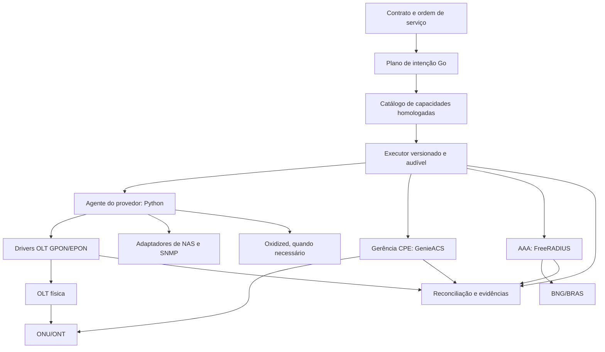

# NexoISP — Dossiê mestre de integrações de equipamentos e ecossistema Open Source

**Edição:** 1.2 · **Data de corte:** 24/10/2026 · **Idioma:** português (Brasil)  
**Projeto analisado:** [TavaresEnok/nexoisp](https://github.com/TavaresEnok/nexoisp)  
**Abrangência:** OLT GPON, EPON, XGS-PON; ONU/ONT/CPE; OMCI, TR-069, TR-369, TR-098, TR-181, TR-143, SNMP, TL1, SSH, Telnet, NETCONF/RESTCONF/YANG; PPPoE/IPoE, BNG/BRAS, RADIUS/CoA; NOC, backups, GIS, OSS e software open source.  
**Material:** consolidação das pesquisas anteriores de compatibilidade de IXC, SGP, HubSoft, TopSapp e Voalle, mais pesquisa ampliada em GitHub sem restrição de linguagem.  
**Natureza:** levantamento técnico e plano de integração, **não certificação de interoperabilidade**.

> **Advertência decisiva:** “Marca mencionada em um catálogo”, “código encontrado no GitHub”, “repositório atualizado”, “método implementado”, “teste em emulador”, “teste em hardware físico” e “homologado em produção” são afirmações diferentes. Este dossiê preserva essa distinção. Não se deve anunciar suporte comercial no NexoISP sem evidência específica por **fabricante + modelo + firmware + operação**.

---

## Sumário

1. Objetivos, escopo e método de pesquisa
2. Resumo executivo e decisões estratégicas
3. Como interpretar compatibilidade de equipamentos e protocolos
4. Concorrentes: SGP, HubSoft, IXC, IXC ACS, TopSapp e Voalle
5. Matriz consolidada de fabricantes e famílias de OLT
6. Inventário de concentradores PPPoE, BNG e NAS
7. ONUs, ONTs, roteadores e homologação de CPE
8. Matriz funcional de operações necessárias
9. Pesquisa GitHub: bibliotecas de drivers OLT/ONU
10. Pesquisa GitHub: NMS/OSS, automação, inventário e backbones
11. Pesquisa GitHub: ACS/TR-069, USP/TR-369, PPPoE e RADIUS
12. Acervos de MIBs/OIDs, parsers, fixtures e firmware
13. Candidatos descartados, simulados e limitações encontradas
14. Ranking por valor efetivo de integração e maturidade
15. Auditoria do estado atual do NexoISP
16. Arquitetura proposta e contratos de drivers
17. Modelo de dados do catálogo de compatibilidade
18. Segurança, isolamento multi-tenant e licenciamento
19. Homologação prática, evidências e critérios de aceite
20. Roadmap incremental e ordem por fabricante
21. Estratégia de busca massiva com GitHub, Zoekt e Semgrep
22. Pendências, riscos e decisões abertas
26. Anexo III — avaliação crítica das fontes DMZ ZTE/FiberHome/V-SOL (acréscimo v1.2)
23. Bibliografia, referências diretas e caminhos de código
24. Registro de fontes fornecidas pelo solicitante e limitações de acesso
25. Comandos de OLT por fabricante e operação

---

## 1. Objetivos, escopo e método de pesquisa

### Objetivo de produto

Construir uma camada de integração que dê ao NexoISP cobertura funcional comparável aos ERPs brasileiros especializados (SGP, IXC, HubSoft, TopSapp, Voalle), usando **o máximo de trabalho verificavelmente aproveitável de código aberto**, independentemente da linguagem de origem. O frontend oficial permanece React/Vite/TypeScript e o backend Go/PostgreSQL; o agente de site pode continuar Python e serviços externos podem ser usados por API quando isso reduzir custo total e risco.

### Hipóteses investigadas

- Existe uma biblioteca universal, maior que Netmiko/Paramiko, com drivers prontos para quase todas as OLTs/ONUs? **Não foi localizada evidência suficiente de uma solução única com tal escopo.**
- Há bibliotecas que conhecem comandos de alto nível e dados específicos de fabricantes? **Sim:** ONMT, KusumaVisionNMS, pyvsol, coletores SNMP e modelos Oxidized.
- Há grandes plataformas OSS/NMS reutilizáveis? **Sim:** OB-BAA, VOLTHA, NMS Prime, LibreNMS, OpenNMS, Zabbix, NetBox, Nautobot, OpenWISP e eNMS; não são intercambiáveis com drivers de autorização.
- Há catálogos de resposta CLI, OIDs e parâmetros ACS? **Sim:** NTC Templates, LibreNMS, Zabbix Community Templates, GenieACS Community, modelos NetBox e outros.
- A linguagem impede o uso? **Não:** pode-se **portar um componente pequeno**, **executar um serviço externo** ou **usar apenas seu conhecimento/fixtures**, respeitada a licença.

### Método efetivamente empregado

1. Busca web e leitura de documentação oficial de concorrentes e padronizadores.
2. Pesquisa de repositórios no GitHub e exame de metadados (atividade, linguagem, licença reportada, tamanho e comunidade).
3. Inspeção seletiva da árvore de arquivos e código-fonte dos candidatos prioritários e do NexoISP.
4. Comparação das operações anunciadas com os métodos e comandos realmente implementados.
5. Classificação de lacunas e risco de adoção. Não houve deploy dos candidatos, medição independente de desempenho, pentest ou testes em equipamentos reais.

**As estrelas do GitHub são indicativos fracos de adoção; não medem qualidade do driver.** Projetos de nicho com 1 estrela podem conter código útil, mas exigem validação redobrada. Dados públicos e firmwares mudam; revalidar tudo antes da incorporação.

### Escala de evidência recomendada

| Nível | Sigla | Interpretação operacional |
|---|---|---|
| 0 | `CATALOG_ONLY` | Fabricante/modelo apenas listado por concorrente ou README |
| 1 | `CODE_PRESENT` | Código/comando/OID localizado e inspecionado |
| 2 | `SYNTHETIC_TEST` | Testado com mock, fixture ou emulador |
| 3 | `LAB_HARDWARE` | Executado em equipamento físico com firmware registrado |
| 4 | `PILOT_VERIFIED` | Operação confirmada em provedor piloto, rollback e auditoria |
| 5 | `PRODUCTION_CERTIFIED` | Regressão, segurança, isolamento e suporte/observabilidade definidos |

Uma operação pode estar no nível 4 para leitura óptica e no nível 1 para alteração de WAN no **mesmo modelo**. A classificação pertence à **operação**, não apenas à marca.

## 2. Resumo executivo e decisões estratégicas

| Achado verificado | Impacto | Ação para NexoISP |
|---|---|---|
| HubSoft declara **27 marcas** e **mais de 65 modelos** de OLT integrados | Paridade exige amplo catálogo de famílias, não uma OLT isolada | Inventário vivo e drivers multi-firmware |
| SGP publica **9 plataformas/famílias** de concentradores NAS | RADIUS/CoA deve falar múltiplos dialetos de BNG | Perfis e atributos por NAS |
| IXC possui integração direta por OLT e indireta via UNMS/SmartOLT/Conscius | Integração via gerenciador pode acelerar cobertura | Criar adaptadores API e drivers nativos separadamente |
| IXC ACS lista **centenas? Não**: uma lista extensa, com pelo menos 147 entradas numeradas na página consultada, incluindo ONTs e roteadores | Paridade por CPE é uma matriz própria de capacidades | Catálogo por modelo/firmware/TR-098/TR-181 |
| ONMT tem comandos Telnet/TL1 em **FiberHome/Nokia/ZTE/Datacom** | Bom material de driver real independente de PHP | Portabilidade seletiva |
| KusumaVisionNMS contém serviços GPON/EPON e associação ACS | Aproveitar OIDs, scripts e validações | Extrair por família com revisão |
| Oxidized implementa CLI/backup para muitos sistemas e várias OLTs | Evita reinventar login, pager, prompts e backups | Serviço externo de backup + referência de drivers |
| SignalHunter tem coletores Rust SNMP para 7 fabricantes | Diagnóstico óptico e sensores multivendor | Prototipar leitura e normalização |
| NTC Templates traz amostras Huawei SmartAX; LibreNMS traz fixtures ZTE C320 | Corrige fraqueza de testes somente com emulador próprio | Construir laboratório de respostas reais anonimizadas |
| GenieACS já existe no NexoISP | Não precisa construir ACS do zero | Mapear parâmetros, proteger tenants e homologar CPEs |

**Decisão central:** não implantar dezenas de ERPs/NMS paralelos. Manter o NexoISP como sistema de registro, com camada `capability registry -> plano de ação -> adaptador -> observação pós-ação`, utilizando módulos externos apenas quando justificáveis.

**Principais alvos iniciais:** Huawei MA56xx/MA58xx; ZTE C300/C320 e Titan C600; FiberHome AN5516/AN6000; Datacom DM461x; V-SOL e C-DATA em GPON/EPON; Intelbras 4840E e G08/G16; MikroTik RouterOS, Huawei NE40/NE8000, Accel-PPP e demais NAS por demanda.

## 3. Como interpretar compatibilidade de equipamentos e protocolos

### 3.1 Separar rede óptica, serviços e gerenciamento de CPE

```text
                               NexoISP (Go + PostgreSQL)
                            Contrato / cliente / tenant / OS
                                        |
                            Orquestrador de operações
                     ___________________|____________________
                    |                   |                    |
            Agente de site          ACS/USP             Motor RADIUS
             SSH/TL1/SNMP          GenieACS            FreeRADIUS
                    |                   |                    |
               OLT GPON/EPON       CPE/ONT via IP          NAS/BNG
                    |                   |                    |
               OMCI / ExtOAM   TR-069/TR-369/CPE        PPPoE/IPoE
                    |                   |                    |
                  ONU ---------- ONT integrada -------- Assinante
```

- **OLT ↔ ONU**: interoperabilidade óptica, registro por serial/LOID/MAC, serviço VLAN/GEM/T-CONT/DBA, OMCI (em GPON) e OAM estendido em muitas implantações EPON.
- **ERP ↔ OLT**: driver CLI/SSH/Telnet/TL1, SNMP, NETCONF/RESTCONF ou API do fabricante/gerenciador. O ERP **não substitui** a compatibilidade entre OLT e ONU.
- **ERP ↔ CPE/ONT via ACS**: TR-069/CWMP ou TR-369/USP; requer firmware do equipamento, alcance IP, autenticação e perfil correto de parâmetros.
- **ERP ↔ NAS/BNG**: RADIUS AAA/accounting/CoA/Disconnect + API/CLI específicas para consulta de sessões, QoS, VLANs e controle avançado.
- **Modelo de dados ≠ protocolo:** TR-098/TR-181 definem objetos/semântica; TR-069 e USP fazem gerência; TR-143 especifica diagnósticos.

### 3.2 Matriz de protocolos e dependências

| Tecnologia | Padrão/método | Depende principalmente de | Responsabilidade no NexoISP | Cuidado |
|---|---|---|---|---|
| GPON | ITU-T G.984/G.988 | OLT, ONU e perfil OMCI | Driver PON e templates | Extensões proprietárias |
| EPON | IEEE 802.3ah/ExtOAM, variantes | OLT e ONU | Driver EPON próprio | Não reutilizar script GPON sem adaptação |
| XGS-PON | ITU-T G.9807.1 | OLT/ONU/ópticos compatíveis | Novo perfil tecnológico | Não equivale a GPON somente por porta combo |
| OMCI | ITU-T G.988 | Stack OLT/ONU | Observação/comando via OLT | Não é API universal exposta pelo ERP |
| TR-069/CWMP | Broadband Forum | Firmware CPE + ACS + IP | GenieACS integrado à API Go | Connection Request e fila |
| TR-369/USP | Broadband Forum | Agente USP + controlador | Controlador separado futuro | Não presumir GenieACS=USP |
| TR-098 | Modelo de dados legado | Implementação da CPE | Mapeamento parâmetro | Instâncias variáveis |
| TR-181 | Modelo de dados moderno | Implementação da CPE | Mapeamento parâmetro | Mesmo recurso pode mudar caminho |
| TR-143 | Diagnósticos CPE | CPE e servidor de medição | Solicitar, acompanhar e validar teste | Disponibilidade não é universal |
| SNMP (idealmente v3) | IETF + MIBs | Agente do equipamento/OIDs | Monitorar topologia/óptica | Escala/unidades/índice por firmware |
| SSH/CLI | Fabricante | CLI/firmware/credenciais | Driver seguro com comandos fechados | Prompt/pager/erros/rollback |
| Telnet/TL1 | Fabricante/legado | Gerência de OLT | Adaptador legado via VPN/isolamento | Credenciais em claro no Telnet |
| NETCONF/YANG | IETF | Servidor NETCONF/YANG | Adaptador tipado | Desvios por fabricante |
| RESTCONF | IETF | Servidor RESTCONF | Adaptador de API | Nem todo equipamento implementa |
| RADIUS/CoA | RFCs + atributos vendor | NAS e servidor AAA | Políticas e ações por NAS | Origem NAS/tenant, idempotência |
| IPoE/DHCP | NAS, servidor DHCP, Option 82 | Acesso e BNG | Perfil separado de PPPoE | IPoE não é simplesmente PPPoE sem senha |

### 3.3 A ONU/ONT não é automaticamente “suportada” pelo ERP

Uma ONT pode registrar em MA5800 e falhar na configuração da interface VEIP; pode provisionar bridge por OMCI, mas não oferecer Wi-Fi por TR-069; pode ter TR-181 em um firmware e TR-098 em outro; pode identificar-se pelo serial GPON e pelo ACS com identificadores diferentes. Compatibilidade é a **combinação**: `(OLT vendor/model/fw, PON technology, ONT vendor/model/hw/fw, access profile, management protocol, operation)`.

Exemplos de operações independentes: descoberta, autorização, leitura de sinal, status, boot/reboot, bridge, roteamento, PPPoE WAN, DHCP WAN, Wi-Fi SSID/senha, atualização de firmware, VoIP, IPTV, upgrade, TR-069 bootstrap, correlação ACS, reset, cancelamento e substituição de ONU.

### 3.4 CGNAT e ACS

CPE geralmente inicia sessões CWMP, então TR-069 funciona atrás de NAT; mas **Connection Request** iniciado pelo ACS pode não alcançar a CPE atrás de CGNAT. A API deve distinguir `queued` de `applied` e acompanhar `Inform`, timeout e fault. Evitar abrir gerenciamento residencial indiscriminadamente na internet. Para o SaaS compartilhado, planejar ACS por domínio/instalação, isolamento por identificação e autenticação CWMP, e conectividade por VPN/site quando necessário.

### 3.5 Ópticos B+/C+/C++

Classes ópticas e módulos SFP interferem no orçamento óptico e na capacidade do enlace, não representam bibliotecas ou drivers de ERP. Registrar classe óptica, potência e alarmes no inventário; não usar classe B+/C+ como indicador de suporte administrativo. Tecnologia XGS-PON merece camada própria para evolução futura.

## 4. Concorrentes: SGP, HubSoft, IXC, IXC ACS, TopSapp e Voalle

| Plataforma | Evidência pública | O que isso prova | O que **não** prova |
|---|---|---|---|
| **HubSoft** | Wiki “OLTs integradas” declara 27 marcas e mais de 65 modelos, com protocolos por modelo | Catálogo comercial explícito | Que cada ONU/firmware e cada ação são suportados |
| **SGP/TSMX** | Wiki com lista de OLTs GPON/EPON e nove famílias de concentrador | Compatibilidade anunciada por família/modelo/versão | Suporte integral de ações; lista não exaustiva mundial |
| **IXC Provedor** | Docs de OLT e integrações indiretas por UNMS, SmartOLT e Conscius | Gestão por API de plataformas intermediárias e drivers diretos em outras docs | Acesso direto a toda OLT do mercado |
| **IXC ACS** | Página comparativa com modelos de ONT/roteadores e matriz de homologações | Separação por modelo/firmware e operação CPE | Todas as entradas serem ONUs GPON ou suportarem toda função |
| **TopSapp** | Página comercial de integrações | Diversas categorias de soluções anunciadas | Lista aberta de modelos/firmwares e operações verificadas |
| **Voalle/elleven** | Categorias de provisionamento, STFC, MVNO, financeiro, rede neutra, OSS, canais e caderno de API | Ecossistema de conectores e processos | Drivers específicos de OLT presentes no código público |

### 4.1 HubSoft — uso correto da contagem

A wiki exibe: **BDCOM, CDATA, CHIMA, CIANET, CISCO, DATACOM, DIGISTAR, FIBERHOME, FURUKAWA, GIGATELCO, HIOSO, HSGQ, HUAWEI, INTELBRAS, NOKIA, OVERTEK, PARKS, PHYHOME, RAISECOM, TENDA, THINK, TP-LINK, UBIQUITI, V.SOL, ZHONE, ZYXEL e ZTE**. O valor **27** é declaração dessa wiki, não censo mundial. Exemplos de protocolos: BDCOM GP3600/GP3600B Telnet; C-DATA FD110X/FD120X Telnet; Cianet E8PS SSH; Datacom DM4610/DM4615 SSH; TP-Link P1201 Telnet; UFiber OLT HTTP. Não inferir que Telnet seja a única via possível na família, nem que a mesma sintaxe funcione em cada firmware.

### 4.2 SGP — catálogo de OLTs e NAS

Lista pública cita C-DATA, Cianet, CHIMA, Datacom, Digistar, FiberHome, Fit Network, Furukawa, GigaTelco, HiOSO, Huawei, Intelbras, Nokia, Overtek, Parks, PhyHome, Raisecom, TP-Link, Think, UFiber, Unifibra/Neutral, V-Solution, ZTE, Zyxel e 2Flex (além de famílias adicionais em referências de parceiros). ZTE C300/320/350 e C610/620/650/680; Huawei MA56xx/MA58xx; Intelbras EPON 4840E, GPON G08/G16/8820; V-SOL EPON V1600D e GPON G1; Nokia por **release**. Algumas entradas estão marcadas “em teste” ou “verificar com suporte”.

No PPPoE, aparecem as nove famílias: **Accel-PPP, Cisco, Huawei NE20/NE40/NE8000, Juniper, Nokia SR, MikroTik RouterOS, TMSoft vRouter, Ubiquiti EdgeRouter e NetElastic**. Uma família pode conter vários modelos e gerações; não usar “9 modelos” como contagem global.

### 4.3 IXC — acesso direto e indireto

A página “Integrações OLT” especifica gerenciadores **UNMS, SmartOLT e Conscius** por IP/domínio, porta, URL base e credenciais/API, com busca de OLTs. Isso é **integração indireta**. Outras páginas de IXC descrevem drivers diretos específicos por modelo e firmware para Huawei, ZTE, FiberHome, Nokia, TP-Link, V-SOL e outras. O inventário deve ter um campo `integration_method=direct|manager_api|acs`, sem somar indevidamente a cobertura de uma plataforma à cobertura nativa.

### 4.4 IXC ACS — matriz útil de CPEs

A documentação compara dispositivos por marca, firmware e funções como WAN, Wi-Fi, PPPoE, IPv6, reboot/reset, firmware e diagnóstico. A página consultada apresenta pelo menos **147 entradas numeradas** e continua com outros modelos; há roteadores não ópticos, duplicatas de hardware/firmware e agrupamentos. Não usar “145 ONUs” como estatística de modelos GPON distintos.

### 4.5 TopSapp e Voalle — ecossistema fora da OLT

O escopo competitivo inclui assinatura digital, CPF/CNPJ, mapas (OZmap/GeoSite/semelhantes), central de atendimento, canais WhatsApp/SMS/e-mail, telefonia, SVA/OTT/IPTV, gateways de pagamento, bancos/Pix/boletos, nota fiscal, rede neutra e APIs de terceiros. Nem todas as plataformas divulgam endpoints, operações e licença; considerar **integração potencial** em vez de compatibilidade operacional comprovada. Não expandir esse domínio antes de fechar o núcleo de rede e financeiro homologados.

### Fontes oficiais

- SGP OLT: https://wiki.sgp.net.br/wiki.php?id=olts_que_o_sgp_integra
- SGP técnico/NAS: https://wiki.sgp.net.br/wiki.php?id=integracoes_tecnicas
- SGP comercial: https://www.tsmx.net.br/sgp/
- HubSoft OLT: https://wiki.hubsoft.com.br/pt-br/modulos/rede/equipamento_conexao/olt_integradas
- HubSoft cloud: https://hubsoft.io/integracoes/olt-cloud/
- IXC OLT/API: https://wiki-erp.ixcsoft.com.br/documentacao/menu-sistema/provedor/integracoes/integracoes/integracoes-olt.html
- IXC ACS dispositivos: https://central-ixcacs.ixcsoft.com.br/documentacao/dispositivos%20homologados/comparativo-homologacoes.html
- TopSapp: https://topsapp.com.br/integracoes
- Voalle: https://grupovoalle.com.br/pt-BR/integracoes

## 5. Matriz consolidada de fabricantes e famílias de OLT

A tabela abaixo reproduz o **inventário de 33 marcas/linhas comerciais candidatas** construído nas pesquisas anteriores. “SGP/HubSoft/IXC” indica **menção confirmada no material mapeado**, não garantia de operação; ausência de marcação indica ausência na matriz coletada, não prova de incompatibilidade. Grupos OEM podem compartilhar plataforma técnica e exigir um só driver-base.

| Marca/família | Exemplos de modelos ou versão catalogados | SGP | HubSoft | IXC na matriz coletada | Situação NexoISP |
|---|---|:---:|:---:|:---:|---|
| BDCOM | — | — | ✓ | — | Sem driver físico homologado identificado |
| C-DATA | FD1104S EPON; famílias GPON | ✓ | ✓ | — | Sem driver físico homologado identificado |
| CHIMA | SGT8016W; SGT8000A-V2 em teste | ✓ | ✓ | — | Sem driver físico homologado identificado |
| CIANET | E8PS; G8PS; G8PSX | ✓ | ✓ | ✓ | Sem driver físico homologado identificado |
| CISCO | — | — | ✓ | — | Sem driver físico homologado identificado |
| DATACOM | DM4610; DM4611; DM4615 | ✓ | ✓ | ✓ | Sem driver físico homologado identificado |
| DIGISTAR | Consultar firmware | ✓ | ✓ | ✓ | Sem driver físico homologado identificado |
| FIBERHOME | RP700/RP1000/RP1100/RP1200/RP1300; AN5516; AN6000; AN6001 | ✓ | ✓ | ✓ | Sem driver físico homologado identificado |
| FURUKAWA | LD3016; LD3032; LightDrive 2500 | ✓ | ✓ | ✓ | Sem driver físico homologado identificado |
| GIGATELCO | Consultar firmware | ✓ | ✓ | — | Sem driver físico homologado identificado |
| HIOSO | — | — | ✓ | — | Sem driver físico homologado identificado |
| HSGQ | G08/G016 | ✓ | ✓ | — | Sem driver físico homologado identificado |
| HUAWEI | MA56xx; MA58xx | ✓ | ✓ | ✓ | Huawei experimental |
| INTELBRAS | 4840E EPON; G08; G16; 8820/8820i | ✓ | ✓ | ✓ | Sem driver físico homologado identificado |
| NOKIA | ISAM; 7360 ISAM FX | ✓ | ✓ | ✓ | Sem driver físico homologado identificado |
| OVERTEK | GPON 8835/8836 | ✓ | ✓ | ✓ | Sem driver físico homologado identificado |
| PARKS | Firmware famílias 4.x/6.x | ✓ | ✓ | ✓ | Sem driver físico homologado identificado |
| PHYHOME | FHL104C EPON; FHL208B GPON; FHL2100 GPON | ✓ | ✓ | — | Sem driver físico homologado identificado |
| RAISECOM | Consultar versão | ✓ | ✓ | — | Sem driver físico homologado identificado |
| TENDA | — | — | ✓ | — | Sem driver físico homologado identificado |
| THINK | — | — | ✓ | — | Sem driver físico homologado identificado |
| TP-LINK | P1201-08 | ✓ | ✓ | ✓ | Sem driver físico homologado identificado |
| UBIQUITI / UFIBER | UF-OLT; versão a confirmar | ✓ | ✓ | — | Sem driver físico homologado identificado |
| V-SOL / VSOLUTION | V1600D/D2/D4/D16 EPON; G1/G1-B; V1600GS/GT | ✓ | ✓ | ✓ | Sem driver físico homologado identificado |
| ZHONE | — | — | ✓ | — | Sem driver físico homologado identificado |
| ZYXEL | 1408; 2406 | ✓ | ✓ | — | Sem driver físico homologado identificado |
| ZTE | C300/320/350; C600/610/620/650/680 | ✓ | ✓ | ✓ | Sem driver físico homologado identificado |
| FIT NETWORK | FNL4000 | ✓ | — | — | Sem driver físico homologado identificado |
| MAXPRINT | Consultar suporte | ✓ | — | — | Sem driver físico homologado identificado |
| UNIFIBRA / NEUTRAL | Neutral-E08; Unifibra-XE08 | ✓ | — | — | Sem driver físico homologado identificado |
| 2FLEX | 2F-FG8P | ✓ | — | ✓ | Sem driver físico homologado identificado |
| CAMBIUM NETWORKS | — | — | ✓ | — | Sem driver físico homologado identificado |
| VENKO NETWORKS | — | — | ✓ | — | Sem driver físico homologado identificado |

**Interpretação:** (1) a união de listas de concorrentes gera marcas adicionais, mas não corresponde à contagem de marcas únicas de fabricantes mundiais; (2) nomes como V-SOL/Vsolution ou linhas OEM podem se sobrepor; (3) há famílias de placa/release dentro do mesmo chassis; (4) classes GPON, EPON e XGS-PON devem ser cadastradas separadamente.

### Matriz técnica inicial por família

| Família | Técnica mais útil | Fontes públicas reutilizáveis | Operações candidatas |
|---|---|---|---|
| Huawei MA56xx/MA58xx | CLI SSH; SNMP para observabilidade | Driver NexoISP, Oxidized SmartAX, NTC SmartAX, SignalHunter, ALLinPOL | descoberta, perfis, sinal, ONU, serviço, backup |
| ZTE C300/C320 | CLI/Telnet/SSH, SNMP | ONMT, Kusuma, Oxidized, snmp-olt-zte, LibreNMS | GPON, service-port, WAN, sinal, cópia, backup |
| ZTE Titan C600+ | CLI e SNMP próprios | ONMT C600, Kusuma Titan, SignalHunter | inventário, GPON, perfis e óptica, com firmware específico |
| ZTE EPON | ExtOAM/CLI por fabricante | Kusuma script EPON (não homologado fisicamente no módulo identificado) | registro por MAC, VLAN, SLA |
| FiberHome AN5516 | TL1, CLI, SNMP | ONMT FiberHome, SignalHunter | descoberta, óptica, autorizar, WAN/VEIP e portas |
| Datacom DM461x | CLI e SNMP | ONMT DM4612, SignalHunter | ONU, sinal, alarmes, VLAN |
| C-DATA GPON | SNMP com MIB 17409/34592, CLI | Kusuma `CDataGponSnmpService` | RX, SN, fabricante, estado, status |
| C-DATA EPON | SNMP e CLI específicos | Kusuma módulo C-DATA EPON | LLID, estado, VLAN e operações conforme firmware |
| HiOSO EPON | SNMP, Telnet | Kusuma `HiosoEponSnmpService` e `HiosoCliWriteService` | alarmes e operações controladas |
| V-SOL GPON/EPON | CLI própria, SNMP por modelo | Oxidized V-SOL, pyvsol | backup, leitura, descoberta; autorização a homologar |
| Intelbras 4840E EPON | SNMP/CLI conforme firmware | Zabbix Community Templates | telemetria, autorização futura |
| Nokia ISAM FX | TL1/Telnet/SNMP | ONMT Nokia, SignalHunter | ONT, perfis, óptica, diagnóstico |
| TP-Link DeltaStream | SSH/Telnet/SNMP por modelo | Oxidized TPLink, SignalHunter, IXC | óptica, reboot e backup quando disponível |

**Atenção a EPON:** aprovar por MAC/LLID, configurar SLA e VLAN via CLI/ExtOAM não é idêntico a GPON OMCI, que trabalha com ONT-ID, GEM, T-CONT, line-profile e service-port. Mesmo chassis e até marca podem exigir contratos de driver separados.

## 6. Inventário de concentradores PPPoE, BNG e NAS

### Lista de nove famílias publicada pelo SGP

| Família | Formas de integração a investigar | Prioridade | Observações |
|---|---|---|---|
| Accel-PPP | FreeRADIUS AAA/Accounting/CoA, arquivos/config API local | P1 | Software NAS Linux, não biblioteca de controle de Huawei |
| Cisco | RADIUS standard/VSA, CoA, SSH/NAS session commands | P2 | ASR e linhas por release; QoS/IPv6 precisam perfil |
| Huawei NE20/NE40/NE8000 | FreeRADIUS + VSA Huawei; CoA/Disconnect; CLI opcional | P0/P1 | Forte aderência ao laboratório/mercado ISP; validar PPPoE real |
| Juniper | RADIUS + Juniper VSAs; NETCONF/CLI; CoA | P2 | MX e outras famílias BNG |
| Nokia SR | RADIUS/VSA; CLI/NETCONF conforme plataforma | P2 | 7750 SR e releases específicos |
| MikroTik RouterOS | API RouterOS v6/v7, RADIUS, CoA e `/ppp active` | P0 | CHR testado no NexoISP; homologar CCR físico |
| TMSoft vRouter | RADIUS, API/CLI por plataforma | P3 | Exige documentação de fornecedor |
| Ubiquiti EdgeRouter | EdgeOS API/CLI, RADIUS | P3 | Validar recursos reais de CoA e perfis |
| NetElastic | BNG API/CLI e RADIUS | P3 | Plataforma vBNG a avaliar por edição |

**Outros candidatos fora da lista SGP de nove:** ZTE ZXR10 BRAS/vBRAS, H3C BRAS, 6WIND vBNG e outras plataformas de mercado. Não contá-los automaticamente como integração existente no SGP.

### Capacidades por NAS exigidas pelo NexoISP

1. Autenticar PPPoE por login/senha com escopo inequívoco de tenant e NAS, inclusive **mesmos usernames em provedores distintos**.
2. Accounting Start, Interim-Update e Stop; correlacionar sessão por NAS, Acct-Session-Id, início e atualização.
3. Disconnect-Request / CoA-Request assinados/autorizados pelo caminho adequado e relatório de ACK/NAK/timeouts.
4. Velocidade, pool IP, IP fixo, simultaneidade, VLAN, IPv6 e prefixo delegado por perfil/atributo suportado.
5. Suspensão: reject versus perfil reduzido/página de aviso; mudança de estado não equivale a derrubada de sessão.
6. Diferenciar rede PPPoE, IPoE/DHCP, hotspot, L2 e VLAN empresarial, inclusive quando combinados no mesmo NAS.
7. Escalar redundantemente: dois processos FreeRADIUS no mesmo host **não** substituem redundância de host/disco/rede.
8. Proteger o backend: usuário comercial/tenant nunca escolhe arbitrariamente `NAS-IP-Address` ou identidade física de origem para consultar sessões de outro tenant.
9. Nunca construir string de VSA dinamicamente sem contrato por fabricante e validar o read-back de políticas.

### Fontes e implementações de referência

- SGP NAS: https://wiki.sgp.net.br/wiki.php?id=integracoes_tecnicas
- FreeRADIUS: https://github.com/FreeRADIUS/freeradius-server
- Accel-PPP: https://github.com/accel-ppp/accel-ppp
- vBNG OS: https://github.com/veesix-networks/osvbng
- RouterOS Go: https://github.com/go-routeros/routeros
- NexoISP NAS atual: https://github.com/TavaresEnok/nexoisp/blob/main/services/network-agent/nexo_agent/drivers/mikrotik_radius.py

## 7. ONUs, ONTs, roteadores e homologação de CPE

### 7.1 Famílias presentes no IXC ACS e em fontes consultadas

| Marca | ONTs/roteadores citados nas homologações públicas | Atenção |
|---|---|---|
| Huawei | EG8041V5; EG8145V5-V2; EG8145X6; HG8141XR; HG8245Q2; HS8145V5 | Diferenciar ONT GPON de roteador Wi-Fi Ethernet |
| ZTE | F6201B; F6600P; F670L; F670Y; F680; F673AV9; F8648P | Firmware e fabricante OEM mudam parâmetros |
| FiberHome | AN5506-02F1G; HG6143D; HG6145F; HG6245D; HG6144F | Mesma referência pode ser comercializada por outras marcas |
| Datacom | DM985-424; DM986-204; DM986-414; DM986-416 | Rev. hardware e interoperabilidade OMCI são importantes |
| Nokia | G-1426G-A/D; G-2425G-A/B; G-1425G-A/B | Perfis Nokia não são automaticamente universais |
| C-DATA | FD514GS1-R550; FD514GS1-R580; FD514GS3-R880; FD714GS1-R850 | Variação de parâmetros CWMP/OEM |
| V-SOL | V2802DAC; V2804AX30-H | Comparar EPON/GPON e bridge/router por modelo |
| Intelbras | HG6145F3; SR1041E/F; W5/W6 | Parte da lista contém roteadores não ópticos |
| Think | TK-ONU-AC-2GE; TKONU2PDPX; TKONUAX3000V | Verificar Wi-Fi/WAN/GPON por firmware |
| TP-Link | XC220-G3; XGB430v Pro; EX220; EX510; Archer (roteadores) | Não tratar todos como ONUs GPON |
| Outras | BaudTec, Chima, CIOT, Cudy, Easy4link, MitraStar, Parks, Raisecom, Shoreline, Unee etc. | Consultar matriz por modelo no IXC ACS |

**Contagem:** a página do IXC ACS possui muitas entradas numeradas e agrupadas; não foi derivada uma quantidade segura de modelos únicos de ONU, porque mistura roteadores, ONTs, firmware e revisões. A homologação de ACS é **independente** da OLT de acesso em parte importante das funções.

### 7.2 Matriz de capacidades ONU/CPE a exigir

| Grupo | Campos/funções | Via mais comum |
|---|---|---|
| Identidade | fabricante, modelo, serial, OUI, MAC PON, revisão hardware, firmware | OLT + ACS |
| Acesso óptico | registro, autenticação SN/LOID/MAC, PON, status, LOS/Dying Gasp | OLT |
| Óptica | RX ONU, TX ONU, RX na OLT, Tx SFP PON, temperatura, distância, limiares | OLT/SNMP ou ACS se houver parâmetro |
| Rede | VLAN, GEM, T-CONT, bridge/VEIP/routers, LAN ethernet | OLT/OMCI ou ACS |
| WAN | PPPoE/IPoE/DHCP/static, VLAN WAN, NAT e IPv6 PD | OLT/OMCI ou ACS |
| Residencial | SSID 2,4/5 GHz, senha, canal, mesh, hosts conectados | ACS/TR-069/TR-369/API CPE |
| Suporte | reboot, reset, diagnóstico DNS/ping, firmware, desempenho TR-143 | ACS e/ou OLT |
| Operacional | cópia/substituição de ONU, history, manutenção, OS vinculada | NexoISP + driver |

### 7.3 Correlação OLT ↔ ACS

O exemplo `KusumaVisionNMS/app/Services/Genieacs/GenieacsOnuMatcher.php` tenta vincular ONU física a CPE usando serial exato e MAC com offset ±1, rejeitando ambiguidades. Essa regra foi descrita pelo projeto para uma rede específica; **não generalizar deslocamentos de MAC para todas as ONTs**. No NexoISP, criar `acs_device_binding` autenticado, com escopo tenant, prova de origem, associação manual aprovada quando houver ambiguidade e nunca autoassociar cliente de provedor diferente.

### 7.4 Critério de paridade com IXC ACS

A meta não é “reconhecer 147 dispositivos” e exibir tudo como disponível. É oferecer operações certificadas por modelo/firmware, com estado `unsupported`, `detected`, `available`, `hardware_verified` e `temporarily_unavailable`, e **suporte parcial explícito**.

Fonte: https://central-ixcacs.ixcsoft.com.br/documentacao/dispositivos%20homologados/comparativo-homologacoes.html

## 8. Matriz funcional de operações necessárias

A tabela abaixo transforma o comparativo com ERPs em requisitos funcionais; inclui as **18 áreas/itens-chave** do inventário anterior, acrescidos de requisitos transversais. A existência da tela no frontend não prova capacidade no backend.

| Domínio | Função a demonstrar | Critério mínimo de aceite |
|---|---|---|
| OLT | Descoberta de chassis/boards/PON | Inventário idempotente por tenant e firmware |
| GPON | ONU não autorizada | Serial, porta e modelo de origem confiável |
| GPON | Autorizar | Serviço/VLAN/perfis aplicados e verificados |
| EPON | ONU não autorizada e registro por MAC/LLID | ExtOAM/CLI por família, sem script GPON reaproveitado cegamente |
| ONU | Desautorizar e substituir | Leitura prévia, alvos explícitos, reversão documentada |
| ONU | Reboot / enable / disable / reset | RBAC, confirmação e impacto para assinante |
| ONU | Optical RX/TX e telemetria | Origem, timestamp, unidade correta, status do valor |
| OLT | VLAN/QinQ/portas/GEM/T-CONT/DBA | Perfil com diferenças de vendor/firmware |
| OLT | Backup da configuração | Coleta e restauração orientada, dados protegidos |
| ACS | Aprovisionar/associar CPE | Credencial CWMP, relação tenant/contrato |
| ACS | Wi-Fi/WAN/PPPoE/IPv6 | Parâmetros testados e fault/read-back |
| ACS | Firmware | Lista homologada, agendamento e recuperação |
| ACS | TR-143 | CPE suporta objeto, servidor de testes e resultado |
| NAS | RADIUS AAA/accounting | Usuários, sessão, plano, VSA, tenant |
| NAS | CoA/Disconnect | Resposta ACK/NAK e sessão observada |
| NAS | IPoE/Hotspot/IPv6 PD | Perfil por fabricante/protocolo |
| NOC | Alarmes, LOS coletivo, Dying Gasp | Correlação por PON, limiar por contexto |
| GIS | PON/CTO/ONU/cliente | Ligação de inventário/OS/mapa com fonte única |
| Operação | Jobs em lote e OS | Etapas, idempotência, auditoria, segurança |
| API | Gerenciadores externos OLT Cloud/SmartOLT/etc. | Operações explicitamente cobertas pelo endpoint da plataforma |

### Operações perigosas merecem contrato distinto

`reset_factory`, `delete_onu`, `remove_service_port`, `upgrade_firmware`, `change_acs_endpoint` e `change_pppoe_password` exigem dupla verificação de alvo e operação. Reaplicar sem leitura pós-timeout pode derrubar múltiplos clientes ou deixar equipamentos inacessíveis. Telas devem exibir o impacto planejado antes de gravar.

## 9. Pesquisa GitHub: bibliotecas de drivers OLT/ONU

**Critério de prioridade:** repositórios com código de alto nível para GPON/EPON têm valor direto maior que bibliotecas genéricas de sessão. A linguagem não foi usada como critério eliminatório. O ranking diferencia material **adotável**, **extraível**, **apenas referência** e **não comprovado**.

### 9.1 ONMT — Optical Network Manager Toolkit (PHP/Laravel)

- **Repositório:** https://github.com/paulo-hortelan/onmt
- **Licença declarada:** MIT; push observado em 25/09/2026; comunidade GitHub pequena (1 estrela no snapshot).
- **Escopo no README:** FiberHome AN5516-04/06/06B (TL1), Nokia FX16 (Telnet/TL1), ZTE C300/C600 (Telnet), Datacom DM4612 (Telnet).
- **Objetivo:** API de alto nível para descoberta, óptica, provisionamento, reinicialização, limpeza e gravação de lotes de comandos.
- **Arquivos verificados:** `src/Services/Fiberhome/Models/AN551604.php`, `src/Services/Nokia/Models/FX16.php`, `src/Services/ZTE/Models/C300.php`, `src/Services/Datacom/Models/DM4612.php`, DTOs em `src/DTOs/`, conexões TL1/Telnet.
- **Evidência concreta:** FiberHome usa comandos TL1 `LST-OMDDM`, `LST-ONUSTATE`, `LST-PORTVLAN`; Datacom utiliza `show interface gpon discovered-onus | nomore` e `show interface gpon ... onu`; Nokia tem DTO `HguTr069SparamConfig` e métodos de gerenciamento de interfaces; ZTE implementa configurações próprias de C300.
- **Testes:** projeto contém cenários de provisionamento contra ambiente de hardware configurado por variáveis de ambiente; inspeção mostrou cenários marcados `skip()`. Não interpretar contagem de testes como prova de homologação de todos os modelos.
- **Aproveitamento:** **portar intencionalmente** contratos/comandos/parsers ao agente Python; ou avaliar microserviço PHP isolado para família em que o porte seria caro. Não requer migrar backend Go.
- **Atenção:** Telnet pode expor credenciais em trânsito; usar isolamento de rede e preferir transportes cifrados suportados pelo dispositivo. Revisar sanitização CLI e recuperação de falha parcial.

### 9.2 KusumaVisionNMS — NMS FTTH com ZTE, C-DATA e HiOSO

- **Repositório:** https://github.com/Masamune21-dev/KusumaVisionNMS
- **Stack:** PHP/Laravel, API, serviços CLI/SNMP, aplicações auxiliares; licença declarada MIT; push em 23/10/2026; cerca de 45 estrelas no snapshot.
- **Famílias:** ZTE C300/C320/C600; C-DATA GPON/EPON; HiOSO EPON. A menção V-SOL na descrição deve ser interpretada com atenção: **o README informa limitações e a versão pública não comprova suporte geral V-SOL**.
- **Provisionamento:** `app/Services/ZteProvisioningScriptBuilder.php` gera `interface gpon-olt`, `onu ... type ... sn`, `tcont`, `gemport`, `service-port`, `pon-onu-mng`, `tr069-mgmt` e WAN conforme perfil; possui diferenciação de C600 e variante bridge.
- **EPON:** `app/Services/Zte/Epon/ZteEponProvisioningScriptBuilder.php` gera autorização por MAC, SLA e VLAN. O comentário do código diz expressamente que determinada implementação não foi executada contra OLT real. Evidência `CODE_PRESENT`, não `LAB_HARDWARE`.
- **MIB C-DATA:** `app/Services/CData/CDataGponSnmpService.php` registra OIDs 17409/34592, diferenças entre FD1608S-B1 e FD1601S-B1, valores e fallback CLI; dados do projeto citam verificações em 28/09/2026.
- **EPON C-DATA/HiOSO:** `app/Services/CData/CDataEponSnmpService.php`, `app/Services/Hioso/HiosoEponSnmpService.php`, `app/Services/Hioso/HiosoCliWriteService.php`.
- **Outros componentes:** backup de configuração, leitura de potência, histórico, alarmes, APIs de inventário, API v1, coleta NOC, mapa ODP/ONU, REST, integração opcional GenieACS e aplicativo móvel.
- **Correlação ACS:** `app/Services/Genieacs/GenieacsOnuMatcher.php` usa serial e MAC com tolerância restrita ±1; rejeita vínculos ambíguos. Não replicar heurística MAC sem validação da família e escopo tenant.
- **Pontos de adoção:** extrair os serviços **por responsabilidade**: parser SNMP C-DATA, script ZTE GPON, adapter HiOSO e correlacionador ACS. Não transformar o ERP Laravel em segundo sistema de clientes.
- **Riscos:** alguns scripts aceitam CLI customizado/credenciais; não expor isso como execução arbitrária no SaaS; auditar SQL/segredos/SSRF e idempotência antes de embutir.

### 9.3 Oxidized — comunicação e backup para grande diversidade de equipamentos

- **Repositório:** https://github.com/ytti/oxidized
- **Stack:** Ruby; licença Apache-2.0; cerca de 3.624 estrelas e atividade em 23/10/2026 no snapshot.
- **Escopo:** automação de backup/versionamento de configuração, com grande biblioteca de modelos de sistemas e fabricantes. O catálogo oficial menciona mais de 130 tipos de SO, mas a lista de OLTs é um subconjunto.
- **Modelos inspecionados:** `lib/oxidized/model/smartax.rb` (Huawei SmartAX), `zteolt.rb` (ZTE C300/C320), `vsololt.rb` (V-SOL GPON), `zhoneolt.rb`, `tplink.rb` (DeltaStream e equipamentos TP-Link), além de RouterOS/VRP.
- **Evidência:** configuração de prompts, pós-login (`undo interactive`, `undo smart`, `scroll`), pager, processamento de caracteres de controle, filtragem de segredos e comandos `show running-config` / `display current-configuration`.
- **Diferencial V-SOL:** modelo `vsololt.rb` trata linhas assíncronas de alarme, paginação `--More--`, NUL/backspace e sintaxe da CLI. Esse conhecimento é útil mesmo se o sistema não for instalado.
- **Uso recomendado:** serviço de backup especializado acessível por API controlada, ou adaptar os modelos/regex à camada de transporte do agente. **Não declara autorização genérica de ONU.**
- **Riscos:** snapshots de configuração podem conter credenciais; criptografar repositório de backup e segregar tenant; exportação/restauração exigem escopo de equipamento inequívoco.

### 9.4 SignalHunter — telemetria óptica multivendor em Rust

- **Repositório:** https://github.com/gondimcodes/signalhunter
- **Stack:** Rust; GPL-3.0; aproximadamente 6 estrelas no snapshot; push 13/10/2026.
- **Drivers examinados:** `src/collector/vendors/huawei.rs`, `zte.rs`, `fiberhome.rs`, `nokia.rs`, `datacom.rs`, `parks.rs`, `tplink.rs`.
- **Escopo do código:** coleta SNMPv2c, mapeamento de OIDs por fabricante, índices de interfaces/ONU, potências, estado e motivos de queda, temperatura, tensão e distância, análise histórica.
- **Cobertura anunciada:** Huawei MA5800/MA5608T/MA5680T; ZTE C300/C320/C600/C650; FiberHome AN5516; Datacom DM461x; Nokia ISAM/Lightspan; Parks Fiberlink; TP-Link DeltaStream. **Esses modelos/firmwares são alegações da documentação do projeto, não validação independente deste relatório.**
- **Atenção a confiabilidade:** o código usa heurísticas/fallbacks para derivar slot/porta a partir de OIDs; exigir cruzamento com descoberta do chassis antes de atribuir dados a um assinante. Não estimar OLT-RX quando faltam leituras físicas e apresentar o valor como medido.
- **Uso recomendado:** consultar tabelas OID e parsers como base para coletores próprios; avaliar serviço separado de telemetria em vez de portar Rust apenas por conveniência. Preferir SNMPv3 em redes que o suportem.

### 9.5 snmp-olt-zte — serviço SNMP ZTE C300/C320

- **Repositório:** https://github.com/Cepat-Kilat-Teknologi/snmp-olt-zte
- **Stack:** Go, MIT; ~43 estrelas; push 23/10/2026.
- **Arquivos:** `internal/repository/snmp.go`, `internal/handler/onu.go`, `internal/model/onu.go`, `pkg/snmp/snmp.go`.
- **Diferencial:** pool de conexões, semáforo para concorrência, GETBULK/GETNEXT, fallback para respostas problemáticas, OIDs, traps, multi-OLT, cache e API HTTP.
- **Uso:** SNMP de ZTE por serviço externo ou extrair lógica de OID e test cases para backend/coletores; a licença MIT facilita avaliação. Não é biblioteca de provisionamento nem substitui RADIUS.

### 9.6 pyvsol — Netmiko adaptado a V-SOL

- **Repositório:** https://github.com/n4y33mkh4n/pyvsol
- **Stack:** Python, MIT; ~1 estrela; push 24/05/2026.
- **Arquivos:** `pyvsol/driver.py`; `pyvsol/templates/vsol_show_*.textfsm`; fixtures em `tests/fixtures/`.
- **Contribuição:** preparação de sessão CLI V1600D/G, `enable`, prompt, paginação moderna/legada, leitura de ONUs e valores ópticos por parser.
- **Limite:** histórico curto, sem prova ampla de modelos/firmwares. Usar como transporte experimental, não “driver completo GPON/EPON”.

### 9.7 Bibliotecas menores e alternativas adicionais

| Projeto | Linguagem | Principal utilidade | Fonte/limite |
|---|---|---|---|
| `juaquicar/jmq_olt_huawei` | Python | Comandos de consulta Huawei MA56xx via Telnet | https://github.com/juaquicar/jmq_olt_huawei ; baixo volume e Telnet |
| `bistaalish/olt-management-api` | Python/FastAPI | API de gerenciamento Huawei OLT | https://github.com/bistaalish/olt-management-api ; revisão de qualidade |
| `LucasRochaAbraao/snmp-lib-huawei` | Python | Consultas SNMP Huawei | https://github.com/LucasRochaAbraao/snmp-lib-huawei ; escopo estreito |
| `Matthew1471/EdgeOS-API` | C# | Abstração EdgeOS/UFiber/Ubiquiti | https://github.com/Matthew1471/EdgeOS-API ; atividade antiga e licença a revisar |
| `net-eleven/multivendor-olt-vlan-troubleshooter` | vários | Diagnóstico de VLAN multivendor | https://github.com/net-eleven/multivendor-olt-vlan-troubleshooter ; verificar implementações |
| `juaquicar/gpon-engineering-docs` | documentação | Informações sobre engenharia GPON | https://github.com/juaquicar/gpon-engineering-docs ; conhecimento, não driver |
| `Cepat-Kilat-Teknologi/genieacs-relay` | vários | Integração ACS / relay | https://github.com/Cepat-Kilat-Teknologi/genieacs-relay ; não substitui o ACS |
| `GeiserX/n8n-nodes-genieacs` | JavaScript/TS | Integração de fluxos n8n com ACS | https://github.com/GeiserX/n8n-nodes-genieacs ; automação auxiliar |
| `gondimcodes/signalhunter` | Rust | Coleta óptica multivendor | Já analisado acima; não é provisionador |

**Regra para bibliotecas de nicho:** não declarar compatibilidade só porque o modelo aparece no nome do repositório. Inspecionar modo real versus demo, conexões, testes de hardware, versão do firmware e limites da licença.

## 10. Pesquisa GitHub: NMS/OSS, automação, inventário e backbones

### 10.1 Plataformas de telecom de alto porte

| Projeto | Repositório | Stack / licença conhecida | Valor estratégico | Limitação |
|---|---|---|---|---|
| **OB-BAA (Broadband Forum)** | https://github.com/BroadbandForum/obbaa | Java e serviços; Apache-2.0 | Camada abstrata de acesso, device adapters, YANG/NETCONF, vOMCI, medições e interfaces padronizadas | Código principal com baixa atividade recente; não é driver de MA5800 pronto |
| **VOLTHA** | https://github.com/opencord/voltha-go | Go e microsserviços; verificar licença por componente | Abstração OLT/ONU, fluxos, adaptação de rede de acesso | Concentra-se em hardware/arquiteturas específicas; alto custo de implantação |
| **OpenOLT Adapter** | https://github.com/opencord/voltha-openolt-adapter | Go; licença por repositório | Adaptador para OLT OpenOLT em ambiente VOLTHA | **Não** equivale a suporte universal de OLT GPON proprietária |
| **NMS Prime/CableLabs** | https://github.com/cablelabs/os-provisioning | PHP/Laravel; Apache-2.0 no núcleo comunitário | OSS de provisionamento, DOCSIS, FTTH, DSL e Wi-Fi, módulos comerciais e integrações | Alguns módulos específicos (ex. Calix) podem ser fechados; verificar o código público |
| **eNMS** | https://github.com/eNMS-automation/eNMS | Python; GPL-3.0 | Workflows de automação para dispositivos de rede | Genérico; não traz matriz de ONU/firmware pronta |

OB-BAA oferece exemplos de criação/deploy de vendor adapters SNMP, tratamento de YANG, vOMCI, gerenciamento de access nodes, telemetria e até PPPoE VNF. É a principal **referência de arquitetura abstrata telecom**, mas seria desproporcional incorporá-lo inteiro em um SaaS voltado inicialmente a pequenos ISPs.

VOLTHA/OpenOLT devem ser estudados principalmente se a estratégia comercial incluir redes de acesso desagregadas/whitebox. Não usá-los para prometer suporte automático às famílias Huawei/ZTE/FiberHome.

NMS Prime deve ser estudado pelo fluxo fim a fim **contrato → perfil → provisionamento de rede**, preservando o fato de que nem todas as integrações comerciais estão publicamente disponíveis no GitHub.

### 10.2 NMS, monitoramento e source of truth

| Projeto | Linguagem predominante | Uso legítimo no NexoISP | Limite |
|---|---|---|---|
| LibreNMS | PHP | Descoberta SNMP, MIBs, sensores, OIDs, exemplos de ZTE e Nokia | Leitura/monitoramento, não autoriza ONU universalmente |
| Zabbix | C/Go/PHP e templates | Coleta, alarmes, triggers e itens de equipamento | Não executa provisionamento PON automaticamente |
| OpenNMS | Java | Alarmes, eventos, topologia, descoberta | Complexidade operacional e banco paralelo |
| NetBox | Python/Django | Inventário físico/portas, catálogo externo, IPAM | Uma source-of-truth paralela pode divergir do ERP |
| Nautobot | Python/Django | Inventário, Apps, Jobs, automação | Não inserir como segundo ERP sem delimitar autoridade |
| OpenWISP | Python/Django | Adoção/configuração de roteadores (muito focado em OpenWrt), VPN/certificados | Não substitui GenieACS universalmente |
| Oxidized | Ruby | Backup, CLI e modelos de sessão | Especializado em config, não provisioning |
| Netpalm | Python | REST broker para CLI/NAPALM/Jinja2/TextFSM/TTP | Shell/CLI deve ficar restrito; sem drivers GPON comprovados |

### 10.3 Frameworks gerais de automação e leitura

| Projeto | URL | Função | Por que não basta sozinho |
|---|---|---|---|
| Netmiko | https://github.com/ktbyers/netmiko | Sessão SSH/Telnet e padrões de prompts | Não conhece o serviço comercial nem todo CLI GPON |
| Paramiko | https://github.com/paramiko/paramiko | Transporte SSH Python | Camada ainda mais baixa |
| Scrapli | https://github.com/carlmontanari/scrapli | Transporte e interação síncrona/assíncrona | Drivers/parse de OLT são separados |
| Scrapligo | https://github.com/scrapli/scrapligo | CLI no ecossistema Go | Sem catálogo comercial de OLT/ONT |
| NAPALM | https://github.com/napalm-automation/napalm | API multivendor de estado/configuração | Cobertura inicial concentrada em OS de roteador/switch |
| Nornir | https://github.com/nornir-automation/nornir | Inventário e execução paralela por plugins | NexoISP já tem intenção, fila e idempotência próprias |
| eNMS | https://github.com/eNMS-automation/eNMS | Workflows e serviços de automação | Mais útil conceitualmente do que importar núcleo inteiro |
| Ansible Network | https://github.com/ansible-collections/ansible.netcommon | Plugins de redes, CLI/NETCONF | Necessita coleções e módulos específicos do dispositivo |
| NTC Templates | https://github.com/networktocode/ntc-templates | TextFSM de saídas reais | Apenas parser, não fornece canal de execução |
| NetBox Device Type Library | https://github.com/netbox-community/devicetype-library | Modelos físicos em YAML | Modelos de portas não são homologação de driver |
| OpenConfig | https://github.com/openconfig/public | Modelos YANG padronizados | Equipamento real pode não implementar o modelo |

**Diretriz:** um framework genérico só é vantajoso se entregar redução mensurável do trabalho de transporte, retries ou parsing. O NexoISP já possui **orquestração, fila e operação assinada**; duplicá-las em Nornir/eNMS sem necessidade concreta é regressão arquitetural.

## 11. Pesquisa GitHub: ACS/TR-069, USP/TR-369, PPPoE e RADIUS

### 11.1 GenieACS como núcleo TR-069 (mantido)

- https://github.com/genieacs/genieacs — ACS CWMP, API NBI, provisioning scripts, presets, virtual parameters; licença reportada AGPL-3.0; código TypeScript.
- Já presente na arquitetura NexoISP, separado da API Go e com MongoDB.
- Compatibilidade real depende de firmware CPE, TR-098/TR-181, extensões específicas, bootstrap CWMP, link IP, ACS credentials e capacidade de Connection Request.
- A API NBI aceita consulta de devices e criação de tasks; retorno HTTP 202 significa fila, não aplicação imediata. O NexoISP precisa persistir estados `queued`, `running`, `applied`, `fault`, `expired` e `unknown`.

### 11.2 GenieACS Community: perfis e virtual parameters

- **Fonte:** https://github.com/mauroalx/genieacs-community (MIT; criado em 22/10/2026; ~1 estrela no snapshot).
- **Quantidade apresentada:** 46 virtual parameters, além de presets, provisions, configurações de interface e importador.
- **Arquivos:** `virtual-parameters/PON_RX_dBm.txt`, `PON_TX_dBm.txt`, `WAN_PPPoE_Usuario.txt`, `WAN_PPPoE_Senha.txt`, `WiFi_SSID_24.txt`, `WiFi_Senha_24.txt`, `IPv6_Prefixo.txt`, `Sys_Firmware.txt`, presets Huawei e ZTE.
- **Técnica:** normaliza `InternetGatewayDevice.*` TR-098 e `Device.*` TR-181, com tentativas de atender `X_HW_*`, `X_ZTE-COM_*`, `X_FH_*`.
- **Risco confirmado no código:** `provisions/provision-zte.txt` contém instrução que liga UPnP. Nunca importar automaticamente este preset em produção; retirar configurações não autorizadas e auditar campos com senha.
- **Alegação de escala:** README menciona experiência com mais de 90 mil CPEs; sem comprovação independente na presente pesquisa. Histórico público do repositório é muito curto.
- **Estratégia:** aproveitar **mapas de leitura** por família, medir read-only com CPE piloto e só depois habilitar escrita seletiva em Wi-Fi/WAN. Tokens ACS e endpoints não devem ser expostos ao cliente/tenant.

### 11.3 Plataformas TR-369 / USP e ACS alternativas

| Projeto | Fonte | Papel e limite | Licença do repositório observada |
|---|---|---|---|
| OktopUSP | https://github.com/OktopUSP/oktopus | Controlador USP e ACS CWMP; contém APIs de Wi-Fi/firmware, transportes MQTT/WebSocket e serviços próprios; verificar edição e isolamento tenant | Apache-2.0 |
| OpenUSP | https://github.com/n4-networks/openusp | Controlador USP em Go; requer avaliação de atualização/cobertura | Apache-2.0 |
| OB-USP-Agent | https://github.com/BroadbandForum/obuspa | **Agente** USP em C instalado do lado CPE; não substitui controlador NexoISP | BSD-3-Clause |
| SKYACS | https://github.com/skydashnet/SKYACS | ACS CWMP alternativo; funcionalidades do firmware precisam homologação | AGPL-3.0 |
| FreeACS | https://github.com/freeacs/freeacs | ACS Java mais antigo, alternativa comparativa | MIT |
| GoACS | https://github.com/goacs/goacs | ACS em Go, atividade histórica; avaliar antes de trocar | MIT (metadados vistos) |

**Regra:** manter GenieACS enquanto não houver evidência de que outro ACS melhore compatibilidade e operações reais. A adoção de USP deve ser uma interface nova com isolamento tenant, nunca uma substituição “por ser escrito em Go”.

### 11.4 PPPoE, BNG e AAA open source

| Software | URL | Papel | Aplicação |
|---|---|---|---|
| FreeRADIUS | https://github.com/FreeRADIUS/freeradius-server | AAA, accounting e políticas, CoA conforme configuração | Núcleo existente |
| Accel-PPP | https://github.com/accel-ppp/accel-ppp | Servidor PPPoE/IPoE/NAS no Linux | NAS de laboratório e plataforma suportada |
| osvbng | https://github.com/veesix-networks/osvbng | BNG software com plano de dados VPP/DPDK | Avançado, não preciso para controlar Huawei |
| go-routeros | https://github.com/go-routeros/routeros | API RouterOS | Sessões, telemetria e ações em NAS MikroTik |
| NetElastic, Nokia SR, Huawei NE e outros comerciais | Docs dos fabricantes | NAS físicos/virtuais | Integrar via RADIUS + VSA + API/CLI apropriada |

Ninguém deve confundir `RADIUS suporta fabricante` com `todos os comandos de BNG da marca estão prontos`. Accounting, rate-limit, perfis, CoA e DHCPv6-PD devem ser **testados por plataforma/release**.

## 12. Acervos de MIBs/OIDs, parsers, fixtures e firmware

Esses conjuntos de dados podem economizar mais horas do que trocar Paramiko por outra biblioteca SSH.

| Fonte | Arquivos/provas de utilidade | Como reutilizar |
|---|---|---|
| NTC Templates | `tests/huawei_smartax/display_ont_info_summary_ont/*.raw` + `.yml`, arquivo `ntc_templates/templates/index` | Fixtures de respostas Huawei; parsers determinísticos |
| LibreNMS | `tests/snmpsim/zxa10_c320.snmprec`, `tests/data/zxa10_c320.json`, diretório `mibs/` | Simulação SNMP e identificação de OIDs ZTE |
| Zabbix Community Templates | `Network_Devices/Intelbras/template_olt_4840e/...`, outras OLTs | Itens SNMP, alarmes e discovery |
| Oxidized | `lib/oxidized/model/{smartax,zteolt,vsololt,zhoneolt,tplink}.rb` | Login, paginação, roteiros de leitura e backup |
| SignalHunter | `src/collector/vendors/*.rs` | OIDs e normalização de telemetria por marca |
| KusumaVisionNMS | `app/Services/CData/`, `app/Services/Zte/`, `app/Services/Hioso/` | OIDs, CLI e operações orientadas a OLT |
| NetBox Device Type Library | `device-types/` e fabricantes em YAML | Modelo de chassis, placas e portas no inventário |
| ALLinPOL | `HUAWEI-OLT-CLI-COMMANDS.md`, `HUAWEI-OLT-ERROR-DATABASE.md`, `skills/` | Checklists e procedimentos por falha e firmware |
| OpenConfig | modelos YANG em `release/models/` | Contratos tipados onde o equipamento efetivamente suporte |
| RTL960x | documentação de OMCI e chipset de ONU | Diagnóstico de interoperabilidade; **não importar firmware/hacks indiscriminadamente** |
| OMCIPcap | projeto de análise de captura OMCI | Diagnóstico de GEM/T-CONT/VLAN e interoperabilidade |

### 12.1 Qualidade de evidência técnica

- Um arquivo `.raw` extraído de dispositivo real e com expectativa `.yml` é uma evidência de **parser**; ainda não prova que o NexoISP consegue provisionar aquele dispositivo.
- MIB ou OID só é válido após confirmação de **modelo/firmware, tipo do dado, escala, índice de PON/ONU e unidade física**.
- Um valor `-20.00 dBm` pode vir escalado em centi-dBm, milli-dBm, inteiro ou string; alguns firmwares usam `-1`, `65535` ou vazio para indisponível. **Jamais** interpretar ausência como 0 dBm.
- A leitura `OLT-RX` não pode ser fabricada a partir de `ONU-TX` sem declaração de estimativa e incerteza.
- Fluxo ideal de evidências: `fonte OID/CLI -> sample real sanitizada -> parser + fixture -> confronto com GUI/CLI -> hardware testado -> matriz certificado`.

### 12.2 Projetos de hardware/firmware

- https://github.com/Anime4000/RTL960x — acervo de interoperabilidade e OMCI de ONTs Realtek, útil para engenharia. Parte do repositório contém firmware/modificações; não é fundamento para distribuição de firmware de terceiros ou falsificação de identificadores.
- https://github.com/RainbowCloudLabs/omcipcap — utilitário para analisar OMCI capturado, não provisionador de OLT.
- Guias de SFP GPON B+/C+/C++: ajudam no orçamento óptico, não na contagem de integrações ERP.

## 13. Candidatos descartados, simulados e limitações encontradas

| Projeto/afirmação | Verificação concreta | Decisão |
|---|---|---|
| `wisnushaputra/NMS-Multi_Brand_OLT` diz Huawei/ZTE/FiberHome | `backend/adapters/huawei_adapter.js` e `fiberhome_adapter.js` fabricam respostas e sucesso; ZTE possui fallback simulado | **Não usar como driver comprovado de produção**; pode servir de exemplo de UI |
| `G-A-S-UNIVERSE/airing` anuncia API multivendor | Drivers reais de produção descritos como privados no material público | Referência de arquitetura, não pacote completo de compatibilidade |
| `OLT-Templates/zabbix-olt-templates` apresenta cobertura extensa | Inspeção encontrou basicamente README e aviso de templates gerados com IA/não prontos | Baixa prioridade, não considerar evidência operacional |
| `KusumaVisionNMS/ZteEponProvisioningScriptBuilder` | Comentário registra falta de teste contra OLT real | Aproveitar comandos apenas em laboratório; não homologado |
| `ONMT` testes FiberHome | Cenários de provisionamento aparecem `skip()` e dependem de env de hardware | Código concreto, mas exigir testes físicos independentes |
| SignalHunter declara desempenho para dezenas de milhares de ONUs | Existem coletores Rust, porém benchmark e escala não foram reproduzidos | Não inserir promessas numéricas de SLA no NexoISP |
| GenieACS Community menciona grande frota | Repositório criado em 22/10/2026; alegação de frota não verificada | Auditoria de scripts e laboratório antes de uso |
| OB-BAA e VOLTHA são grandes | Camada de abstração não equivale a driver direto MA5800/C320/V-SOL | Estudo estratégico, sem prometer cobertura |
| Fabricante presente em ERP | Páginas comerciais nem sempre detalham operação, firmware e método de conexão | Estado `CATALOG_ONLY`, não “homologado” |
| Repositório sem licença | Disponibilização pública não autoriza cópia/derivação indiscriminada | Somente estudo até licença explícita ou autorização |

**Princípio anti-hype:** o próprio código deve mostrar onde há conexão real, tratamento de erro, leitura posterior e testes em hardware. Resposta fabricada ou fallback “sucesso simulado” jamais deve alterar o estado do ERP como se o equipamento tivesse sido configurado.

## 14. Ranking por valor efetivo de integração e maturidade

**Ranking A: ROI direto para drivers GPON/EPON e CPE** (julgamento técnico qualitativo, não medição financeira).

| Ordem | Projeto | Código específico | Maturidade/comunidade | Principal risco | Decisão |
|---|---|---|---|---|---|
| 1 | ONMT | Alta para 4 fabricantes | Baixa comunidade, testes físicos parciais | Telnet e cobertura real | Estudar/portar primeiro |
| 2 | KusumaVisionNMS | Alta em ZTE/C-DATA/HiOSO | Projeto ativo, pequena comunidade | Variantes e ações experimentais | Extrair serviços |
| 3 | Oxidized | Alta em sessão/backup | Alta comunidade e história | Não provisiona ONUs | Serviço externo e modelos |
| 4 | SignalHunter | Alta em SNMP multi-OLT | Comunidade pequena | GPL e claims de benchmark | Referência/serviço opcional |
| 5 | snmp-olt-zte | Alta em SNMP ZTE | Projeto ativo e pequeno | Escopo restrito de telemetria | Avaliar integração rápida |
| 6 | GenieACS Community | Alta em mapas TR-069 | Muito recente | Scripts mutáveis e UPnP | Importar apenas depois de revisão |
| 7 | pyvsol | Média em sessões V-SOL | Pequena | Firmware incerto | Homologação piloto |
| 8 | NTC Templates | Alta para parsing | Comunidade madura | Não executa comandos | Reaproveitar fixtures/parsers |

**Ranking B: escala/arquitetura de plataformas, não drivers prontos**

| Referência | Força | Quando faz sentido |
|---|---|---|
| NetBox/Nautobot | Inventário e source of truth | Grande rede ou catálogo de hardware, evitando fonte paralela |
| LibreNMS/OpenNMS/Zabbix | Telemetria, discovery, alarmes e escala | NOC, observabilidade e OIDs |
| OB-BAA | Arquitetura padronizada de acesso | Integração por adaptadores, vOMCI, YANG/NETCONF |
| VOLTHA | PON desagregada | OLTs compatíveis OpenOLT/whitebox |
| NMS Prime | Provisionamento OSS completo | Inspirar fluxo contrato→rede/serviço |
| eNMS/Nornir/Netpalm | Automação genérica | Apenas se reduzir custo contra executor existente |
| OpenWISP | CPE/roteadores OpenWrt | Implantação com agentes e equipamentos suportados |

Não misturar “mais estrelas” com “melhor driver”. ONMT tem comunidade pequena mas comandos de provisionamento concretos; NetBox tem milhares de usuários, mas não autoriza automaticamente ONTs GPON.

## 15. Auditoria do estado atual do NexoISP

**Base:** leitura direta de arquivos do repositório [`TavaresEnok/nexoisp`](https://github.com/TavaresEnok/nexoisp), `main` consultado, documentação consolidada e drivers. **Commit de referência registrado no levantamento anterior:** `0a6c2a8c285ddffdec7bd6cf06631d6743` (20/10/2026); alterações posteriores exigem nova comparação antes da implementação.

### 15.1 Arquitetura existente — preservar

| Componente | Situação documentada |
|---|---|
| Frontend | React/TypeScript + Vite, servido pelo Caddy; o redesign é o frontend oficial |
| Backend | Go, Chi/Huma, PostgreSQL/pgx, SQL e tarefas River |
| Segurança tenant | `tenant_id` + RLS; políticas separadas e agente identificado por site |
| Executor | Intenções versionadas, operações assinadas Ed25519, agentes mTLS, persistência/reconciliação e tratamento de efeitos incertos |
| Site | Agente Python durável com SQLite local e conexão de saída para API |
| PPPoE | FreeRADIUS integrado; opção RADIUS central ou local, RouterOS CHR validado em laboratório |
| GPON | Driver Huawei SmartAX sobre SSH/Netmiko; testado com emulador interno próprio |
| TR-069 | GenieACS + MongoDB; API Go em `apps/api-go/internal/acs/` |
| Serviços adjacentes | IPAM/CGNAT, NOC e inventário; não substituir sem motivo |

Arquivos de referência:

- `docs/arquitetura.md` — ADRs, responsabilidades e garantias.
- `docs/expansao-olt-onu.md` — contrato e limitações Huawei/ONU.
- `docs/pendencias.md` — pendências homologação e implantação.
- `services/network-agent/nexo_agent/drivers/olt_base.py` — `check`, `discover`, `read_onu`, `authorize`, `deauthorize` e `OnuState`.
- `services/network-agent/nexo_agent/drivers/olt_huawei.py` — SSH/Netmiko, parsing e CLI Huawei.
- `services/network-agent/nexo_agent/drivers/mikrotik_radius.py` — FreeRADIUS local + RouterOS API.
- `apps/api-go/internal/acs/client.go` — API NBI do GenieACS.
- `apps/api-go/internal/radius/` — executor e CoA integrado.
- `db/migrations/00008_olt_onu.sql`, `00009_olt_huawei.sql`, `00052_tr069_cpe.sql` — estruturas relevantes.

### 15.2 Capacidade Huawei efetivamente encontrada

| Operação | Implementação atual | Evidência |
|---|---|---|
| `check` | `display version` | Emulador próprio |
| `discover` | `display ont autofind all` | Emulador próprio |
| `read_onu` | `display ont info by-sn`, service-port, optical-info | Parser e emulador |
| `authorize` | `ont add` + `service-port` | Emulador próprio |
| `deauthorize` | `undo service-port` + `ont delete` | Emulador próprio |
| Perfis de linha/serviço | Precisam existir previamente na OLT | Não automatizado pelo driver |
| VLAN/GEM avançados, multi-serviço | Bridge única, uma VLAN e GEM padrão ajustável | Não homologado |
| Firmware, TR-069/CPE | Via GenieACS separado | Operações ACS reais ainda precisam homologação CPE |
| Outras marcas | Somente driver demo identificado além do Huawei | Nenhuma homologação física evidenciada |

O driver grava marcador `nexo:<id>:v<n>` na descrição da ONU para reconciliar a versão aplicada e diferencia falha parcial/efeito incerto. Essa arquitetura é valiosa e deve ser preservada em todo adaptador novo.

### 15.3 Pendências relevantes antes de produção

- **Huawei:** testar prompts, paginação, formatos de saída, perfil por firmware, falhas parciais e comandos destrutivos **em OLT física**.
- **RADIUS:** CHR não homologa CCR/NE40/Cisco. Validar VSA, suspensão, CoA/Disconnect, IPv6 prefix delegation e NAS por firmware.
- **SaaS multi-tenant:** diferenciar assinantes com o mesmo login PPPoE em provedores diferentes, conforme identidade NAS confiável; garantir não cruzar ONU ou CPE por serial/MAC entre tenants.
- **TR-069:** autenticação CWMP, cadastro automático seguro, parâmetros por modelo, reexecução de task e políticas de Connection Request.
- **Catálogo de templates ONU:** no projeto atual descreve intenção/consulta e playground demonstrativo, **não execução automática de cada template na OLT**.
- **NOC:** limites óticos por provedor, diagnóstico de falha coletiva, histórico real e múltiplos equipamentos.
- **Continuidade:** site local e RADIUS redundantes por host/disco/rede, não somente containers redundantes no mesmo host.
- **Segurança:** segredos em cofre, TLS onde possível, Telnet apenas em redes isoladas, logs sanitizados e revisão de dependências.

### 15.4 Diferenças que exigem atenção na expansão

O NexoISP possui arquitetura superior a muitos scripts avulsos quanto a **intenção versionada, revalidação pré-escrita, auditoria e tratamento de ACK perdido**. Ao portar comandos, nunca substituir esse motor por “executa script e retorna sucesso”. Os drivers devem declarar ações suportadas e obrigatoriamente retornar evidência observada.

Atualização de documentação: alguns arquivos de operação antigos podem descrever IPv6 como futuro, mas `docs/pendencias.md` informa atributo `Delegated-IPv6-Prefix` entregue desde 20/10/2026, ainda sem homologação DHCPv6-PD em NAS real. Tomar evidência do código/commit e teste real como precedência diante de texto contraditório.

## 16. Arquitetura proposta e contratos de drivers

### 16.1 Camadas recomendadas



A figura é conceitual: serviço externo e execução podem usar filas/proxy; não implica comunicação direta da nuvem com Telnet/SSH público.

### 16.2 Registro de capacidades antes da escolha do driver

O ERP deve reconhecer marca/modelo/release com dados **observados**, não por hostname configurado somente pelo usuário. A partir do fingerprint, procurar o driver compatível com a combinação de tecnologia e operação.

Contrato lógico proposto:

```text
DeviceFingerprint:
  vendor, product_family, model, hardware_revision, software_version,
  board_type, pon_technology, management_protocols

Capability:
  key, interface_version, read_only, reversible, required_rights,
  supported_models, firmware_range, prerequisites,
  evidence_level, source_commit, source_license

OperationIntent:
  tenant_id, device_id, contract_id, operation_key,
  target_serial_or_mac, parameters_typed, idempotency_key,
  desired_version, plan_hash, deadline, approval

OperationObservation:
  tenant_id, device_id, operation_id, observed_state,
  source, collected_at, raw_sample_reference, error_code
```

### 16.3 Interface mínima OLT

O contrato atual `olt_base.py` contém `check`, `discover`, `read_onu`, `authorize`, `deauthorize`. Preservá-lo e introduzir interfaces opcionais por capacidade, sem exigir que uma OLT EPON implemente métodos exclusivos de GPON.

```python
# Interface ilustrativa; não é código aplicado ao repositório.
class OltDriver:
    def fingerprint(self) -> dict: ...
    def check(self) -> dict: ...
    def discover(self) -> list[dict]: ...
    def read_onu(self, identifier: str) -> dict: ...
    def authorize(self, desired_state: dict) -> dict: ...
    def deauthorize(self, identifier: str) -> dict: ...
    def supported_capabilities(self) -> set[str]: ...

class OptionalOpticalReader:
    def read_optical(self, identifier: str) -> dict: ...

class OptionalConfigBackup:
    def backup(self) -> bytes: ...
```

**Não** adicionar `execute_arbitrary_cli` ao contrato público do NexoISP. CLI de diagnóstico pode existir internamente com allowlist, variável tipada e aprovação conforme operação.

### 16.4 Modo de incorporação dos projetos

1. **Extrair dados:** importar fixtures, YAML, MIB/OIDs, regex e metadados de equipamento após análise da licença e normalização.
2. **Portar driver pequeno:** converter lógica específica de CLI/TL1/SNMP de PHP/Ruby/Rust para agente Python ou Go; guardar link e commit de proveniência.
3. **Serviço externo isolado:** manter Oxidized, GenieACS ou controlador USP como serviço com autenticação mTLS, escopo por site, timeouts, idempotência e health/metrics.
4. **Usar como referência arquitetural:** OB-BAA/VOLTHA/eNMS/NMS Prime sem incorporar dependências volumosas ou reimplementar suas plataformas.

### 16.5 Fluxo de ativação fim a fim

```text
Contrato pronto
  -> reserva do recurso e validação de plano/OLT/PON
  -> ONU detectada e associada ao contrato (verificação tenant)
  -> autorização PON + VLAN/GEM/serviço
  -> leitura de verificação do estado real da OLT
  -> configuração RADIUS/BNG preparada
  -> correlação e provisionamento de CPE no ACS, se suportado
  -> validação sessão PPPoE/IPoE, WAN e gerência
  -> atualização inventário CTO/OS e estado comercial
  -> ativo ou PENDENTE_PARCIAL com motivo e próxima ação
```

**Sem rollback cego:** se ONU foi autorizada e GenieACS falhou, remover a ONU pode derrubar conectividade de gerenciamento. Registrar `PENDENTE_ACS`, preservar efeitos válidos, replanejar apenas etapas seguras e mostrar incongruências.

### 16.6 Site dedicado versus multi-tenant compartilhado

- Provedores grandes: agentes, ACS e NAS/RADIUS podem residir em infraestrutura dedicada e banco próprio, mantendo API comum.
- Pequenos provedores: backend/PostgreSQL compartilhado com isolamento lógico por tenant, agentes vinculados a site/equipamento e identidades NAS distintas.
- ACS pode ter instalação segregada por provedor ou isolamento comprovado via credenciais, virtualização de domínio e autorização estrita; **servidor GenieACS compartilhado não garante por si só isolamento multi-tenant**.
- Backups, logs SNMP/CLI, nome/MAC/serial de ONUs e eventos RADIUS também são dados vinculáveis ao assinante; precisam isolamento e retenção definidos.

## 17. Modelo de dados do catálogo de compatibilidade

### Entidades propostas

| Entidade | Campos essenciais | Finalidade |
|---|---|---|
| `hardware_vendors` | `id`, `canonical_name`, `aliases`, `oem_of` | Normalização de marcas/OEM |
| `hardware_models` | `id`, `vendor_id`, `model`, `hw_revision`, `type`, `pon_technology` | Catálogo físico sem prometer driver |
| `firmware_families` | `id`, `model_id`, `version_pattern`, `build`, `notes` | Separar dialetos e releases |
| `integration_adapters` | `id`, `driver_key`, `protocol`, `artifact_url`, `commit`, `license`, `maintainer` | Proveniência de código |
| `integration_capabilities` | `adapter_id`, `model_id`, `operation`, `min_fw`, `max_fw`, `preconditions`, `evidence_level` | Matriz de operações |
| `onu_olt_compatibility` | `olt_model`, `olt_fw`, `onu_model`, `onu_fw`, `profile`, `status` | Interoperabilidade óptica/OMCI/ExtOAM |
| `cpe_data_profiles` | `model_id`, `fw_pattern`, `tr_model`, `acs_vendor_parameters`, `read_write` | TR-098/TR-181/vendor |
| `equipment_installations` | `tenant_id`, `site_id`, `device_id`, `model_id`, `firmware_observed` | Equipamento efetivamente do provedor |
| `homologation_evidence` | `tenant_id`, `adapter`, `model`, `fw`, `operation`, `case_id`, `result`, `sample_ref`, `verified_at` | Prova rastreável |
| `operation_intents` | `tenant_id`, `device_id`, `version`, `desired_state`, `plan_hash`, `status` | Fonte desejada de execução |
| `operation_observations` | `tenant_id`, `device_id`, `observed_state`, `collected_at`, `source`, `confidence` | Read-back / reconciliação |
| `acs_device_bindings` | `tenant_id`, `contract_id`, `acs_installation_id`, `device_id`, `serial`, `pon_mac`, `binding_proof` | Associação segura da CPE |
| `nas_profiles` | `tenant_id`, `device_id`, `vendor`, `release`, `vsas`, `coa_mode`, `ipv6_mode` | RADIUS e BNG por fabricante |

### Exemplo de manifesto do driver (proposta; não homologação)

```json
{
  "driver_key": "zte-c320-gpon-cli",
  "vendor": "ZTE",
  "models": ["C300", "C320"],
  "technology": "GPON",
  "management": ["ssh", "telnet_legacy"],
  "capabilities": {
    "discover": "code_present",
    "read_onu": "code_present",
    "authorize_bridge": "code_present",
    "authorize_router": "not_verified",
    "backup_config": "code_present",
    "delete_onu": "not_verified"
  },
  "evidence": {
    "source_repository": "https://github.com/Masamune21-dev/KusumaVisionNMS",
    "source_path": "app/Services/ZteProvisioningScriptBuilder.php",
    "source_commit": "PIN_BEFORE_IMPORT",
    "license_review": "pending",
    "hardware_firmware_tested": []
  }
}
```

`PIN_BEFORE_IMPORT` é marcador de projeto: **não** executar importação sem fixar commit/arquivo/branch e copiar as notas de licença.

### Regras de persistência

- Catálogo global de modelo/licença pode ser público, mas instalações, dados de ONU/CPE, credenciais e evidências do provedor são tenant-scoped.
- RLS também nas tabelas de associação ACS e observações que contêm serial/MAC/IP; queries por serial sem `tenant_id` são proibidas em contexto SaaS.
- `state_observed` deve ter timestamp e origem; ausência de coleta não é estado `offline`.
- Mudança externa gera divergência, não reparo automático sem política e autorização.
- Nunca expor credenciais PPPoE/ACS nas fixtures e nas respostas ao frontend.

## 18. Segurança, isolamento multi-tenant e licenciamento

### 18.1 Requisitos de segurança de drivers/ACS/NAS

1. **Segregar gestão:** OLTs/NAS/ACS ficam em rede de gerenciamento com VPN/ACL; evitar Telnet e SNMPv2c em redes não confiáveis. Usar SSH e SNMPv3 quando suportados.
2. **Não permitir shell arbitrário:** apenas operações previamente catalogadas; validação rigorosa de VLAN, frame/slot/porta, serial, ONU ID, MAC, perfis e nomes.
3. **Atribuir alvo corretamente:** operação sempre carrega `tenant_id`, `site_id`, `device_id`, contrato e prova de associação; rejeitar serial com correspondência ambígua.
4. **Preservar segredos:** cofre/envelope criptográfico, mTLS, tokens por serviço, rotação e logs redigidos. **Não** importar presets que alterem UPnP ou ACS URL sem aprovação.
5. **Controlar mutações:** preview, confirmação para desprovisionamento, janela de mudança, bloqueio de operações concorrentes e leitura pós-ação.
6. **Tratar efeito incerto:** timeout não é falha garantida; consultar antes de repetir. CoA e tarefas ACS também precisam rastreio independente.
7. **Rate limit físico:** limitar SNMP WALK/BULK e sessões Telnet/SSH, preservando CPU de controle da OLT, e usar backpressure.
8. **Auditabilidade:** operador, motivação, OS, antes/depois, resposta sanitizada, resultado e versão do driver.
9. **SaaS:** evitar que uma API de gerenciamento de terceiros com token global mostre dados de outro provedor; aplicar isolamento no adaptador, não só na UI.
10. **LGPD:** dados de assinante, MAC, serial, endereço, histórico de uso e login devem obedecer minimização e controle de acesso.

### 18.2 Matriz de licenças — interpretação operacional

| Família | Exemplo | Consequência típica | Decisão necessária |
|---|---|---|---|
| MIT | ONMT, Kusuma, pyvsol, snmp-olt-zte | Permissiva com preservação de avisos/licença | Confirmar licença do arquivo exato e atribuição |
| Apache-2.0 | Oxidized, OB-BAA, NetBox, OktopUSP | Permissiva, obrigações de aviso/NOTICE e patentes | Observar distribuição, marcas e avisos |
| CC0-1.0 | NetBox Device Type Library | Dedicação ampla do conteúdo | Confirmar metadados terceiros |
| LGPL | Netpalm | Exige análise conforme modo de ligação/redistribuição | Preferir serviço separado se reduzir risco |
| GPL-2/3 | FreeRADIUS (componentes), SignalHunter, eNMS, Accel-PPP | Pode impor obrigações se houver distribuição/derivação sob condições da licença | Jurídico e engenharia avaliam cada artefato |
| AGPL-3.0 | GenieACS, SKYACS e outros | Acesso remoto a versão modificada pode implicar disponibilização de fonte correspondente conforme termos | Revisar alterações e distribuição do serviço |
| Sem licença identificada | Alguns repos demonstrativos | Código público **não** equivale a permissão de incorporar | Não copiar até haver licença/autorização |

**Importante:** não é orientação jurídica. Estar em containers ou serviços separados **não garante** automaticamente que duas obras sejam juridicamente independentes. Da mesma forma, usar um serviço GPL sem modificá-lo pode gerar obrigações distintas de copiar seu código. Verificar arquivo `LICENSE`, `NOTICE`, dependências e o ato concreto (uso interno, modificação, entrega do agente, SaaS, distribuição a provedor dedicado).

### 18.3 Supply chain e execução de código de terceiros

- Fixar tag/commit/SHA de dependências e guardar SBOM quando necessário.
- Analisar pacotes e imagens antes de executar; evitar Dockerfiles que buscam scripts arbitrários da internet em runtime.
- Usar Semgrep/SAST para execução de CLI, injeção, auth/tenant; Gitleaks/TruffleHog apenas para verificar **nossos** repositórios/dependências sob auditoria autorizada, sem extrair ou testar segredos de terceiros.
- Executar drivers experimentais inicialmente em ambiente sem rede de produção, com credenciais de teste e escopo de leitura.
- Fallback de emulação deve ser bloqueado em produção e identificado no retorno ao frontend.

Fontes: https://www.gnu.org/licenses/gpl-faq.en.html e licenças de cada projeto.

## 19. Homologação prática, evidências e critérios de aceite

### 19.1 Roteiro mínimo por combinação fabricante/modelo/firmware

| Etapa | Ensaio | Aprovação |
|---|---|---|
| A | Detectar fingerprint sem mutação | Vendor/model/fw/board conferidos |
| B | Capturar `show`/`snmpwalk` reais com dados anonimizados | Parser reproduz GUI/CLI local |
| C | Descobrir ONU não autorizada | Serial/porta/tecnologia corretos |
| D | Autorizar em VLAN/teste controlado | ONU registrada e serviços observáveis |
| E | Ler ONU, service-port, RX/TX e status | Estado pós-escrita confirmado |
| F | Substituir/reconfigurar sem criar recurso duplicado | Reconciliação idempotente |
| G | Desautorizar apenas ONU piloto | Outros assinantes preservados |
| H | Simular timeout/ACK perdido | Consulta anterior à reexecução |
| I | Falha de conexão, reinício de agente e firmware divergente | Estado `unknown` e recuperação segura |
| J | Tentativa cruzada tenant A/B | Rejeitada na API/agente/ACS/RADIUS |

Não é necessário executar centenas de testes automatizados para cada adaptação inicial. Um conjunto enxuto de fixtures e um ensaio físico **bem documentado por família e operação** gera evidência mais útil que um grande volume de testes mockados.

### 19.2 Homologação por grupo de tecnologia

- **Huawei GPON:** MA5608T/MA5800; bridge, perfis existentes, service-port, leitura RX/TX, exclusão e mudanças manuais.
- **ZTE GPON:** C300/C320; tipos de ONU e `tcont/gemport`, modos bridge/router/VEIP quando aplicáveis; C600 com driver diferenciado.
- **EPON:** C-DATA, Intelbras 4840E, V-SOL/HiOSO, autorização por MAC/LLID, VLAN, SLA, motivo de queda e compatibilidade de OAM.
- **FiberHome:** TL1/CLI com OLT AN5516, código ONMT, provisionamento ONU de marcas diferentes, perfis e conectividade ACS.
- **Datacom:** DM4612/DM461x; CLI e SNMP, revisão DmOS, ONUs via OMCI e funcionamento do sinal.
- **ACS:** no mínimo um CPE Huawei, ZTE, FiberHome, Datacom, Intelbras, TP-Link; TR-098/TR-181, senha Wi-Fi, reboot, WAN e permissão/isolamento.
- **RADIUS:** MikroTik CHR e CCR físicos, Huawei NE40; Auth/Accounting, CoA/Disconnect, speed, IP fixo/pool, IPv6-PD, múltiplos tenants.

### 19.3 Ficha de homologação recomendada

```yaml
vendor: ZTE
olt_model: C320
olt_firmware: INFORMAR_VERSAO_EXATA
pon_technology: GPON
onu_model: INFORMAR_MODELO
onu_firmware: INFORMAR_VERSAO
protocol: SSH_OR_TELNET
operation: authorize_bridge
source_repo: https://github.com/paulo-hortelan/onmt
source_commit: INFORMAR_SHA
lab_date: YYYY-MM-DD
observed_output_reference: fixture_sanitizada.txt
test_result: not_run
verifier: INFORMAR_RESPONSAVEL
rollback_documented: false
tenant_isolation_passed: false
approved_for_production: false
```

### 19.4 Definições de pronto

- **Implementado:** código executa operação tipada; mock/parser passa.
- **Testado em laboratório:** hardware real acessível, operação e leitura posterior com versão/fixture.
- **Homologado piloto:** campo real, rollback/recuperação, sem cross-tenant, observabilidade e operação estável.
- **Compatibilidade comercial:** especificar claramente **qual operação e quais firmwares** estão abrangidos, inclusive limitações.

## 20. Roadmap incremental e ordem por fabricante

### P0 — preservar integridade, antes de “marcas novas”

1. Inventariar NexoISP atual e evitar refatorar frontend oficial; expor registro de capacidades no painel existente.
2. Congelar commits dos candidatos e concluir revisão de licença básica.
3. Corrigir parsing Huawei com fixtures NTC e capturas reais quando disponíveis.
4. Homologar MikroTik PPPoE/RADIUS em equipamento físico e testar isolamento de NAS/tenant.
5. Endurecer associação de CPE/GenieACS e estados de tarefa pendente/fault.
6. Acrescentar diagnóstico SNMP somente leitura antes de provisionamento multivendor.

### P1 — drivers de maior retorno

1. **ZTE C300/C320 GPON:** ONMT + Kusuma; serviço, perfis, sinal, remoção e read-back.
2. **FiberHome AN5516:** ONMT TL1 e fixtures reais.
3. **Datacom DM4612:** ONMT + SignalHunter.
4. **C-DATA/HiOSO EPON/GPON:** drivers Kusuma e prova de firmware.
5. **Huawei NE40:** RADIUS/VSA/CoA e IPv6-PD; operação em ambiente autorizado.
6. **Oxidized:** backup como serviço externo, integração por site.

### P2 — ampliar cobertura do ecossistema

- V-SOL GPON/EPON com pyvsol, Oxidized e piloto real.
- Intelbras 4840E/G08/G16 com templates SNMP e drivers por firmware.
- Nokia ISAM FX16, ZTE Titan C600 e TP-Link DeltaStream.
- Catálogo completo de CPEs TR-098/TR-181 com presets validados.
- Adaptadores de gerenciadores externos SmartOLT/UNMS/Conscius/OLT Cloud quando suas APIs realmente expuserem as operações necessárias.
- Funcionalidades de WAN avançada, IPv6, Wi-Fi 6, firmware e TR-143 por modelo.

### P3 — arquitetura de operadora e evolução

- XGS-PON por perfil e equipamentos combo quando houver piloto.
- USP/TR-369 com controlador separado, avaliando OktopUSP.
- NETCONF/RESTCONF/YANG e modelos OB-BAA/OpenConfig onde realmente suportados.
- BNG de fabricantes e versões adicionais, IPoE, hotspot, VLAN empresarial.
- Integrações GIS (OZmap, GeoSite), canais, telefonia/STFC/MVNO/SVA, bancos/financeiro conforme roadmap próprio.

### 20.1 Entregáveis mínimos por iteração

Cada iteração deve produzir **um** driver ou perfil real, um manifesto, fixtures sanitizadas, estado de homologação e documentação de recuperação. Não repetir dezenas de testes UI sem alteração correspondente; basta smoke do fluxo API→agente→equipamento/fixture, mais ensaio físico ao liberar escrita.

### 20.2 Critérios comerciais

Não estabelecer número de “marcas suportadas” como única meta. Usar indicadores: percentual de operações certificadas por firmware; quantidade de modelos homologados em laboratório físico; uso de drivers com read-back; taxa de falhas recuperadas sem suporte; zero operações cross-tenant; cobertura real de CPEs por fabricante e demanda de piloto.

## 21. Estratégia de busca massiva com GitHub, Zoekt e Semgrep

### 21.1 Fontes e ferramentas

- **GitHub Search**: descoberta ampla de repositórios e código por linguagem/caminho, atividade e licença.
- **Zoekt / Sourcegraph**: indexar repositórios autorizados para pesquisar centenas de milhares de linhas e detectar famílias de comando/OID duplicadas. Fonte: https://github.com/sourcegraph/zoekt
- **ripgrep/ctags**: pesquisa local por árvore e funções após clone legal/autorizado.
- **Semgrep**: auditoria estática para CLI injection, interfaces inseguras, registro de credenciais, SSRF e autorização tenant. Fonte: https://github.com/semgrep/semgrep
- **Gitleaks/TruffleHog**: auditoria de segredos no código do NexoISP e em cópias que possuímos permissão para auditar; **não** instrumento de aquisição de credenciais de terceiros. Fontes: https://github.com/gitleaks/gitleaks e https://github.com/trufflesecurity/trufflehog
- **Dependabot/OSV/SBOM**: segurança da cadeia de suprimentos, quando as dependências forem incorporadas.

### 21.2 Consultas de código de alto valor

```text
"display ont autofind all"
"display ont optical-info"
"show gpon onu uncfg"
"pon-onu-mng" "tr069-mgmt"
"LST-OMDDM" OR "LST-ONUSTATE"
"show interface gpon discovered-onus"
"gponOnuInfoEntry"
"1.3.6.1.4.1.17409"
"1.3.6.1.4.1.34592"
"X_ZTE-COM" "InternetGatewayDevice"
"X_GponInterafceConfig" "RXPower"
"FD1608S" "snmpwalk"
"AN5516" "TL1"
"Huawei SmartAX" "TextFSM"
"ONU" "ExtOAM" "LLID"
"CoA-Request" "Delegated-IPv6-Prefix"
"RADIUS" "Mikrotik-Rate-Limit"
"Device.Optical.Interface" "OpticalSignalLevel"
```

Pesquisar também erros e respostas reais (`Failure:`, `%Code`, `ONTID`, `No entries found`, `More`) para elevar a qualidade dos parsers. Evitar apenas buscas em README com a palavra “multi vendor”.

### 21.3 Funil de triagem de milhares de repositórios

1. Identificar 50–200 candidatos por tema; deduplicar forks e mirrors.
2. Consultar `LICENSE`, datas, stars/forks/commits, release, testes, diretórios e histórico.
3. Localizar **métodos que realmente conectam e executam**, não somente classes/adapters simulados.
4. Marcar `READ_ONLY`, `WRITE_CAPABLE`, `SIMULATED`, `DOC_ONLY` ou `UNVERIFIED`.
5. Extrair amostras de comandos/OIDs, `firmware` e `device_type` com fonte e commit.
6. Classificar licenças e dependências antes de qualquer cópia/adaptação.
7. Submeter os cinco melhores por fabricante à revisão humana e teste controlado.
8. Só então implementar driver versionado e registrar evidência no catálogo.

### 21.4 Estrutura sugerida para acervo interno

```text
docs/integracoes-equipamentos/
  fontes.md
  catalogo-fabricantes.md
  compatibilidade-olt-onu.md
  compatibilidade-acs.md
  nas-radius-vsa.md
  proveniencia/
    <projeto>/<commit>/README-evidencias.md
  fixtures/
    huawei/ma5800/<release>/
    zte/c320/<release>/
    fiberhome/an5516/<release>/
  homologacoes/
    lab-huawei-ma5800.md
    lab-zte-c320.md
    lab-fiberhome-an5516.md
```

Guardar somente dados técnicos autorizados e sanitizados: nunca incluir passwords, tokens, IPs privados reais, CPF, nome de cliente ou serial de produção em fixtures públicas.

## 22. Pendências, riscos e decisões abertas

| Código | Questão | Risco se ignorar | Recomendação |
|---|---|---|---|
| R01 | Telnet/TL1 sem criptografia | Vazamento de senhas de OLT | Somente em rede de gerência isolada, escopo e política |
| R02 | Distinção ONU OMCI versus CPE ACS | Declarar compatibilidade fictícia | Duas matrizes separadas mais correlação |
| R03 | EPON diferente de GPON | Scripts com parâmetros errados | Driver e perfis específicos |
| R04 | Dados ONU por serial/MAC em multi-tenant | Acesso ao assinante de outro provedor | Tenant e prova de associação obrigatórios |
| R05 | Mesmos logins PPPoE em NAS distintos | Acesso cruzado no RADIUS | Namespace confiável de NAS e política por tenant |
| R06 | Dispositivo sem firmware conhecido | Driver errado causar impacto | Discovery e versão antes de escrita |
| R07 | Resposta simulação como sucesso | Provisionamento “fantasma” | Demo bloqueado em produção |
| R08 | SNMP/OID com escala ou índice errado | Potência errada e falsos alarmes | Fixtures reais e normalização |
| R09 | Timeout em comando mutável | Duplicação de service-port/ONU | Read-back antes de repetir |
| R10 | ACS task 202 pendente | UI informa sucesso falso | Máquina de estados e acompanhamento |
| R11 | CGNAT/Connection Request | Mudança Wi-Fi não é entregue imediatamente | Monitorar Inform, usar rede de gestão aprovada |
| R12 | Importar preset de terceiro que altera UPnP/ACS | Risco residencial e indisponibilidade | Revisão linha a linha e opt-in |
| R13 | GPL/AGPL em produto comercial | Obrigações não cumpridas | Jurídico, avisos e arquitetura revisada |
| R14 | Firmware ONT de terceiros | Direitos e interoperabilidade duvidosos | Não distribuir firmware/hacks; só diagnóstico legítimo |
| R15 | Dois bancos/fontes de verdade | Contrato, ONU e ACS divergentes | NexoISP dono do estado desejado; serviços do observado |
| R16 | Integração por API de terceiros | Operações omitidas e credencial global | Mapeamento exato de endpoints/escopos |
| R17 | Muitas execuções massivas | Sobrecarga de CPU da OLT | Throttle, fila por equipamento e janela |
| R18 | Escala de milhares de CPEs | Custo/latência não conhecidos | Benchmark de piloto, sem prometer SLA |

### Decisões propostas a aprovar pelo time técnico

1. Definir **ZTE C320/C300 e FiberHome AN5516** como próximos drivers não-Huawei, sujeito a hardware do piloto.
2. Definir `READ_ONLY` SNMP como primeira fase para toda marca nova.
3. Preservar GenieACS; implementar presets próprios versionados, sem importação automática de terceiros.
4. Usar Oxidized como serviço opcional de backup, não como execução livre de CLI.
5. Manter ONMT/Kusuma/SignalHunter como fontes rastreáveis; importar trechos só após revisão de licença/segurança.
6. Para o SaaS, vincular cada ACS/NAS/agente a tenant e site; instalações dedicadas grandes mantêm isolamento físico.
7. Não contabilizar modelos comerciais compatíveis até o primeiro ensaio físico documentado.

## 23. Bibliografia, repositórios e arquivos diretos examinados

### 23.1 Concorrentes e normas

| Referência | URL |
|---|---|
| SGP — OLT integráveis | https://wiki.sgp.net.br/wiki.php?id=olts_que_o_sgp_integra |
| SGP — Integrações técnicas / NAS | https://wiki.sgp.net.br/wiki.php?id=integracoes_tecnicas |
| SGP — Produto | https://www.tsmx.net.br/sgp/ |
| SGP — GeoSite | https://bookstack.sgp.net.br/books/servicos-de-mapa/page/integracao-geosite-guia-de-uso |
| HubSoft — OLTs integradas | https://wiki.hubsoft.com.br/pt-br/modulos/rede/equipamento_conexao/olt_integradas |
| HubSoft — OLT Cloud | https://hubsoft.io/integracoes/olt-cloud/ |
| HubSoft — API pública GitHub | https://github.com/hubsoftbrasil/api |
| HubSoft — Docs | https://docs.hubsoft.com.br/ |
| IXC — Integrações OLT | https://wiki-erp.ixcsoft.com.br/documentacao/menu-sistema/provedor/integracoes/integracoes/integracoes-olt.html |
| IXC ACS — Homologações CPE | https://central-ixcacs.ixcsoft.com.br/documentacao/dispositivos%20homologados/comparativo-homologacoes.html |
| TopSapp — Integrações | https://topsapp.com.br/integracoes |
| Voalle — Integrações | https://grupovoalle.com.br/pt-BR/integracoes |
| Voalle — caderno API (referência do usuário) | https://documenter.getpostman.com/view/16282829/TzzBqFw1#7fdbd11c-06af-4ab1-ba88-5cda5e49ad42 |
| Broadband Forum — Technical Library | https://broadband-forum.org/public/technical-library/ |
| Broadband Forum — TR-069 para USP | https://www.broadband-forum.org/public/certifications/tr-069-evolution-to-usp/ |
| Broadband Forum — OB-BAA Docs | https://obbaa.broadband-forum.org/using/ |
| GenieACS — Documentação Virtual Parameters | https://github.com/genieacs/genieacs/blob/master/docs/virtual-parameters.rst |
| GPL/AGPL — FAQ GNU | https://www.gnu.org/licenses/gpl-faq.en.html |

### 23.2 Fontes específicas de código verificado

| Projeto/arquivo | Link direto |
|---|---|
| ONMT README | https://github.com/paulo-hortelan/onmt/blob/main/README.md |
| ONMT FiberHome | https://github.com/paulo-hortelan/onmt/blob/main/src/Services/Fiberhome/Models/AN551604.php |
| ONMT Nokia | https://github.com/paulo-hortelan/onmt/blob/main/src/Services/Nokia/Models/FX16.php |
| ONMT ZTE | https://github.com/paulo-hortelan/onmt/blob/main/src/Services/ZTE/Models/C300.php |
| ONMT Datacom | https://github.com/paulo-hortelan/onmt/blob/main/src/Services/Datacom/Models/DM4612.php |
| ONMT teste FiberHome | https://github.com/paulo-hortelan/onmt/blob/main/tests/Fiberhome/ProvisionTest.php |
| Kusuma ZTE GPON | https://github.com/Masamune21-dev/KusumaVisionNMS/blob/main/app/Services/ZteProvisioningScriptBuilder.php |
| Kusuma ZTE EPON | https://github.com/Masamune21-dev/KusumaVisionNMS/blob/main/app/Services/Zte/Epon/ZteEponProvisioningScriptBuilder.php |
| Kusuma C-DATA GPON SNMP | https://github.com/Masamune21-dev/KusumaVisionNMS/blob/main/app/Services/CData/CDataGponSnmpService.php |
| Kusuma correlação ACS | https://github.com/Masamune21-dev/KusumaVisionNMS/blob/main/app/Services/Genieacs/GenieacsOnuMatcher.php |
| Oxidized SmartAX | https://github.com/ytti/oxidized/blob/master/lib/oxidized/model/smartax.rb |
| Oxidized ZTE | https://github.com/ytti/oxidized/blob/master/lib/oxidized/model/zteolt.rb |
| Oxidized V-SOL | https://github.com/ytti/oxidized/blob/master/lib/oxidized/model/vsololt.rb |
| Oxidized Zhone | https://github.com/ytti/oxidized/blob/master/lib/oxidized/model/zhoneolt.rb |
| Oxidized TP-Link | https://github.com/ytti/oxidized/blob/master/lib/oxidized/model/tplink.rb |
| SignalHunter Huawei | https://github.com/gondimcodes/signalhunter/blob/main/src/collector/vendors/huawei.rs |
| SignalHunter ZTE | https://github.com/gondimcodes/signalhunter/blob/main/src/collector/vendors/zte.rs |
| SignalHunter FiberHome | https://github.com/gondimcodes/signalhunter/blob/main/src/collector/vendors/fiberhome.rs |
| snmp-olt-zte pool | https://github.com/Cepat-Kilat-Teknologi/snmp-olt-zte/blob/main/internal/repository/snmp.go |
| pyvsol driver | https://github.com/n4y33mkh4n/pyvsol/blob/main/pyvsol/driver.py |
| GenieACS Community PON RX | https://github.com/mauroalx/genieacs-community/blob/main/virtual-parameters/PON_RX_dBm.txt |
| GenieACS Community SSID | https://github.com/mauroalx/genieacs-community/blob/main/virtual-parameters/WiFi_SSID_24.txt |
| GenieACS Community ZTE provision | https://github.com/mauroalx/genieacs-community/blob/main/provisions/provision-zte.txt |
| NTC Huawei SmartAX fixtures | https://github.com/networktocode/ntc-templates/tree/master/tests/huawei_smartax |
| LibreNMS ZTE C320 SNMP sim | https://github.com/librenms/librenms/blob/master/tests/snmpsim/zxa10_c320.snmprec |
| Zabbix Intelbras EPON 4840E | https://github.com/zabbix/community-templates/tree/main/Network_Devices/Intelbras/template_olt_4840e |
| NexoISP Huawei | https://github.com/TavaresEnok/nexoisp/blob/main/services/network-agent/nexo_agent/drivers/olt_huawei.py |
| NexoISP base OLT | https://github.com/TavaresEnok/nexoisp/blob/main/services/network-agent/nexo_agent/drivers/olt_base.py |
| NexoISP ACS API | https://github.com/TavaresEnok/nexoisp/blob/main/apps/api-go/internal/acs/client.go |
| NexoISP arquitetura | https://github.com/TavaresEnok/nexoisp/blob/main/docs/arquitetura.md |
| NexoISP expansão OLT | https://github.com/TavaresEnok/nexoisp/blob/main/docs/expansao-olt-onu.md |
| NexoISP pendências | https://github.com/TavaresEnok/nexoisp/blob/main/docs/pendencias.md |

### 23.3 Catálogo adicional de projetos examinados e relevantes

- https://github.com/nautobot/nautobot
- https://github.com/netbox-community/netbox
- https://github.com/netbox-community/devicetype-library
- https://github.com/librenms/librenms
- https://github.com/zabbix/zabbix
- https://github.com/zabbix/community-templates
- https://github.com/opennms/opennms
- https://github.com/openwisp/openwisp-controller
- https://github.com/eNMS-automation/eNMS
- https://github.com/tbotnz/netpalm
- https://github.com/napalm-automation/napalm
- https://github.com/carlmontanari/scrapli
- https://github.com/scrapli/scrapligo
- https://github.com/nornir-automation/nornir
- https://github.com/ansible-collections/ansible.netcommon
- https://github.com/BroadbandForum/obbaa
- https://github.com/opencord/voltha-go
- https://github.com/opencord/voltha-openolt-adapter
- https://github.com/cablelabs/os-provisioning
- https://github.com/openconfig/public
- https://github.com/Anime4000/RTL960x
- https://github.com/RainbowCloudLabs/omcipcap
- https://github.com/miaolink/allinpol-skills
- https://github.com/accel-ppp/accel-ppp
- https://github.com/veesix-networks/osvbng
- https://github.com/OktopUSP/oktopus
- https://github.com/n4-networks/openusp
- https://github.com/BroadbandForum/obuspa
- https://github.com/skydashnet/SKYACS
- https://github.com/freeacs/freeacs
- https://github.com/genieacs/genieacs
- https://github.com/Cepat-Kilat-Teknologi/snmp-olt-zte
- https://github.com/go-routeros/routeros
- https://github.com/wisnushaputra/NMS-Multi_Brand_OLT
- https://github.com/G-A-S-UNIVERSE/airing
- https://github.com/OLT-Templates/zabbix-olt-templates

## 24. Registro de fontes fornecidas pelo solicitante e limitações de acesso
25. Comandos de OLT por fabricante e operação

Abaixo preservamos os endereços originalmente fornecidos, inclusive os de contexto técnico, para que nenhuma trilha útil seja perdida. A classificação de acesso indica o que pôde ser usado com confiança nesta consolidação; **não** declara leitura integral de documentos fechados, pagos ou PDF/imagens não examinados.

| Link originalmente fornecido | Uso neste dossiê | Situação |
|---|---|---|
| [IXC integrações OLT](https://wiki-erp.ixcsoft.com.br/documentacao/menu-sistema/provedor/integracoes/integracoes/integracoes-olt.html) | APIs de gerenciadores de OLT | Página textual consultada |
| [Script ONU IXC no Scribd](https://pt.scribd.com/document/857551516/Passo-a-Passo-Script-ONU-IXC) | Modelo de templates e variáveis | Material de terceiro; não transcrito nem validado integralmente |
| [Reddit InternetBrasil](https://www.reddit.com/r/InternetBrasil/comments/1kz0p3r/provedores_locais_que_focam_em_clientes_e_n%C3%A3o/) | Contexto prático de ISP e expectativas de serviço | Contexto comunitário; não é certificação técnica |
| [SGP — OLT](https://wiki.sgp.net.br/wiki.php?id=olts_que_o_sgp_integra) | Modelos GPON/EPON e releases | Página consultada |
| [SGP produto](https://www.tsmx.net.br/sgp/) | Escopo de ERP | Referência comercial |
| [SGP integrações técnicas](https://wiki.sgp.net.br/wiki.php?id=integracoes_tecnicas) | NAS/OLT | Página consultada |
| [Fibrastore GPON B+/C+/C++](https://www.fibrastore.com.br/post/sfp-gpon-b-c-e-c-como-escolher-o-m%C3%B3dulo-correto-para-a-olt) | Orçamento óptico | Referência técnica, não driver |
| [Fórum Intelbras](https://forum.intelbras.com.br/viewtopic.php?t=64290) | Casos e compatibilidade de OLT/ONU | Conteúdo não totalmente confirmado nesta pesquisa |
| [HSGQ GPON/EPON/XGS-PON](https://www.hsgq.com/t/Escolhendo-o-OLT-certo%3A-XGS-PON%2C-GPON-e-EPON-comparados-id09165625.html) | Evolução tecnológica | Referência de tecnologia e especificação |
| [SGP GeoSite](https://bookstack.sgp.net.br/books/servicos-de-mapa/page/integracao-geosite-guia-de-uso) | GIS/OLT/ONU/CTO | Escopo de integração de mapa |
| [HubSoft OLT integradas](https://wiki.hubsoft.com.br/pt-br/modulos/rede/equipamento_conexao/olt_integradas) | 27 marcas e 65+ modelos | Página oficial consultada |
| [HubSoft OLT Cloud](https://hubsoft.io/integracoes/olt-cloud/) | Gerenciador intermediário | Requer leitura das operações disponíveis, não só da plataforma |
| [HubSoft API GitHub](https://github.com/hubsoftbrasil/api) | Integração de ERP por API | Repo público verificado; documentação deve ser confrontada com versão |
| [HubSoft docs](https://docs.hubsoft.com.br/) | Referência de integração | Navegação e acesso podem variar |
| [TopSapp integrações](https://topsapp.com.br/integracoes) | Ecossistema comercial | Página pública com dados textuais limitados |
| [Voalle integrações](https://grupovoalle.com.br/pt-BR/integracoes) | Ecossistema e categorias | Página consultada |
| [Voalle API/Postman](https://documenter.getpostman.com/view/16282829/TzzBqFw1#7fdbd11c-06af-4ab1-ba88-5cda5e49ad42) | API externa | Não extraída matriz completa de endpoints/operções por fabricante |

### Limitações metodológicas finais

- Este é um levantamento **substancial**, mas não um censo exaustivo de todo código no GitHub; um indexador Zoekt local pode revelar milhares de outros projetos/arquivos.
- Alguns repositórios e páginas são novos, mudam diariamente ou contêm drivers gerados por IA; revisão de qualidade precisa continuar durante a implementação.
- O conteúdo de concorrentes é comercial e pode ser maior do que o publicado; o inverso também ocorre quando modelos antigos permanecem no catálogo.
- **Nenhum teste físico foi executado nesta conversa.** Nenhuma biblioteca foi instalada ou integrada no repositório NexoISP por este relatório.
- Contagens de modelos e estrelas valem como instantâneo e são corrigíveis; não substituem homologação por operação e firmware.
- Quando o material está atrás de login ou limitado a imagens/documentos de terceiros, as funcionalidades não foram inferidas sem evidência.

---

## Veredito consolidado

A estratégia correta é **combinar os melhores ativos de vários ecossistemas**, e não substituir Netmiko por outra biblioteca esperando que ela conheça todas as OLTs.

A combinação com maior valor imediato é: **ONMT + KusumaVisionNMS** para descoberta e provisionamento, **Oxidized** para sessão/backup, **SignalHunter + snmp-olt-zte + LibreNMS/Zabbix** para telemetria, **NTC Templates** para parsers e fixtures, **GenieACS com perfis próprios auditados** para CPE, e **FreeRADIUS + contratos NAS** para PPPoE/BNG. **OB-BAA, VOLTHA, NMS Prime, NetBox e Nautobot** permanecem como referência estratégica para a escala seguinte.

**Condição inegociável:** todo suporte anunciado pelo NexoISP deve ter modelo, firmware, operação, nível de evidência e, para escrita em rede, uma homologação real documentada. Essa é a diferença entre apresentar muitas marcas em uma tela e entregar compatibilidade confiável a um provedor.


---

## 25. Anexo técnico de comandos de OLT/ONU — atualização de 24/10/2026

A seção abaixo amplia este dossiê com comandos por família de OLT, fontes, critérios de risco e aceitação. **A documentação principal e todas as seções anteriores foram preservadas.**

## 25.1. Comandos/operações que todo driver precisa mapear

| ID | Capacidade | Entrada estruturada | Saída e verificação esperada | Segurança |
|---|---|---|---|---|
| O01 | Identificar OLT/firmware | equipamento | fabricante, chassis, boards, release, uptime | somente leitura |
| O02 | Descobrir PONs/placas | equipamento | slots, portas, disponibilidade | somente leitura |
| O03 | Descobrir ONU não autorizada | PON opcional | SN ou MAC, VendorID, LOID quando disponível, PON, timestamp | somente leitura |
| O04 | Localizar ONU existente | serial/MAC ou ID | porta PON, ONU-ID, modelo, descrição, contrato associado | somente leitura |
| O05 | Ler estado e causa da queda | identificador | run/admin/config/match state; LOS/dying-gasp; últimas mudanças | somente leitura |
| O06 | Ler sinal RX/TX | ONU/porta | ONU-RX, ONU-TX, **OLT-RX** quando disponível, temperatura, distância, idade da amostra | somente leitura |
| O07 | Enumerar perfis e services | OLT/ONU | line/srv/DBA/TCONT/GEM/service-port/VLAN/UNI/VEIP | somente leitura |
| O08 | Autorizar GPON | SN/LOID/ONT-ID/PON/perfis | ONU criada com identificador correto e serviço verificado | escrita crítica |
| O09 | Autorizar EPON | MAC/LLID/LOID/PON/SLA | binding, estado de registro e VLAN verificados | escrita crítica |
| O10 | Criar/reconciliar serviço | perfis/VLAN/GEM/UNI/VEIP | mapeamento ativo no equipamento, sem colisões | escrita crítica |
| O11 | Alterar plano/VLAN | intenção versionada | leitura posterior consistente e tráfego preservado | escrita crítica |
| O12 | Desativar/reativar | ONU e motivo | admin-state resultante; **não remover cadastro** | escrita crítica |
| O13 | Reiniciar ONU | ONU e justificativa | confirmação de tarefa e reconexão; não assumir imediatismo | interrupção |
| O14 | Remover serviço(s) exclusivos | ONU, lista de vínculos | service-ports/flows exclusivos ausentes | destrutiva |
| O15 | Desautorizar/remover ONU | ONU/posição | binding eliminado; inexistência confirmada | destrutiva |
| O16 | Trocar ONU | serial anterior/novo | validação de identidade, contrato, serviço, auditoria | destrutiva potencial |
| O17 | Backup e diff | OLT | config atual + persistida, versão, hash e segredos mascarados | leitura sensível |
| O18 | Salvar running→startup | OLT | confirmação persistida, observadas particularidades da CLI | escrita ampla |
| O19 | Ler alarmes e eventos | OLT/PON/ONU | códigos brutos+normalizados, severidade, início/fim | somente leitura |
| O20 | Inspecionar portas e MACs | ONU/UNI/uplink | link, estatísticas, MAC, VLAN, erros | somente leitura |
| O21 | Gerenciar gerência TR-069 | ONU/ACS | URL/credenciais por canal seguro; confirmação CPE no ACS | escrita sensível |
| O22 | Diagnóstico massivo | PON/OLT | agregados, limitação de polling, correlação por porta/CTO | leitura escalável |
| O23 | Homologar comportamento | modelo/firmware | fixtures reais, prompt, paginação, erros, rollback, logs | laboratório |
| O24 | Exportar matriz de capacidades | modelo/firmware | flags por operação, fonte, status e data | catálogo |

#### 25.1.1 Modelo lógico (não um script universal)

```text
DISCOVER ONU -> IDENTIFICAR PROTOCOLO/PORTA/MODELO
  -> CHECK PERFIS E PRECONDICOES
  -> PREVIEW / CONFERENCIA DE INTENCAO
  -> AUTHORIZE GPON OU EPON
  -> CONFIGURAR SERVICE-PORT/VLAN/UNI/WAN APENAS ONDE SUPORTADO
  -> READ BACK: SERIAL, ONT-ID, PON, SERVICO, SINAL
  -> REGISTRAR OPERAÇÃO E AUDITORIA
  -> TR-069/USP OPCIONAL VIA CANAL SEPARADO
  -> VERIFICAR SESSAO PPPoE/RADIUS (QUANDO APLICAVEL)
```

**Retirada segura:** `READ BINDINGS -> ENUMERAR SERVIÇOS EXCLUSIVOS -> REVOGAR SERVIÇOS EXCLUSIVOS -> REMOVER BINDING -> READ BACK`. Não apagar VLAN, perfis, GEM ou recursos compartilhados indiscriminadamente.

### 25.2. Huawei SmartAX — GPON MA56xx / MA58xx (confiança A/B; NexoISP não homologado fisicamente)

**Base:** código existente `services/network-agent/nexo_agent/drivers/olt_huawei.py`, [documentação do NexoISP](https://github.com/TavaresEnok/nexoisp/blob/main/docs/expansao-olt-onu.md), [guia de operação Huawei/ONT](https://documentos.infotecms.com.br/huawei-omci/) e documentação pública de integradores. Transportes: CLI SSH e, quando permitido, consultas SNMP específicas.

```text
display version
display board
display ont autofind all
display ont info by-sn <SERIAL>

config
interface gpon <FRAME>/<SLOT>
display ont optical-info <PORTA_PON> <ONT_ID>
display ont optical-info <PORTA_PON> all
```

**Exemplo de linha operacional já implementada no NexoISP — não executar sem validar firmware:**

```text
interface gpon <FRAME>/<SLOT>
ont add <PORTA_PON> sn-auth "<SERIAL>" omci ont-lineprofile-name <LINE_PROFILE> ont-srvprofile-name <SERVICE_PROFILE> desc <MARCADOR_NEXO>
quit
service-port vlan <SERVICE_VLAN> gpon <FRAME>/<SLOT>/<PORTA_PON> ont <ONT_ID> gemport <GEM> multi-service user-vlan <USER_VLAN> tag-transform translate
```

**Remoção no driver existente:** consultar todos os service-ports da ONU, remover apenas os que realmente pertencem à intenção, executar `undo service-port <INDEX>`, entrar na interface GPON e aplicar `ont delete <PORTA_PON> <ONT_ID>`. Verificar inexistência depois. **Variação relevante:** algumas versões usam `ont add <PON> <ONT_ID> ...` e sintaxe com `ont-lineprofile-id`/`ont-srvprofile-id`, não `-name`; o projeto atual não comprova qual é aceita no hardware real.

**Lacunas atuais:** WAN/router e VoIP não suportados pelo driver atual; múltiplos GEMs/service-ports e perfis criados automaticamente também não. Leitura `display ont optical-info` requer validação de parsing real; `ont reset`/outros comandos não devem ser ativados sem fonte e teste específicos.

### 25.3. ZTE ZXA10 — GPON C300/C320/C350 e Titan C600 (confiança A/B; famílias separadas)

**Fontes:** [Intelbras — ONU R1 em ZTE C3xx](https://guiasmanuais.intelbras.com.br/R1/pt-BR/ztec3xx.html), [ONMT C300](https://github.com/paulo-hortelan/onmt/blob/main/src/Services/ZTE/Models/C300.php), [KusumaVision ZTE](https://github.com/Masamune21-dev/KusumaVisionNMS/blob/main/app/Services/ZteProvisioningScriptBuilder.php), [guia técnico ZTE](https://github.com/kaderofficial/OLT-NMS-HUAWEI/blob/main/docs/SMARTOLT_ZTE_C300_C320_C600_GUIDE.md).

**Descoberta, posição, óptica e backup:**

```text
show gpon onu uncfg
show gpon onu by sn <SERIAL>
show gpon onu state gpon-olt_1/<SLOT>/<PON>
show gpon onu detail-info gpon-onu_1/<SLOT>/<PON>:<ONU_ID>
show pon power onu-rx gpon-olt_1/<SLOT>/<PON>
show pon power attenuation gpon-onu_1/<SLOT>/<PON>:<ONU_ID>
show running-config interface gpon-onu_1/<SLOT>/<PON>:<ONU_ID>
show running-config
```

**Exemplo mínimo de autorização por SN** (o tipo deve existir/ser compatível na OLT):

```text
configure terminal
interface gpon-olt_1/<SLOT>/<PON>
onu <ONU_ID> type <ONU_TYPE> sn <SERIAL>
exit
interface gpon-onu_1/<SLOT>/<PON>:<ONU_ID>
tcont 1 name internet profile <TCONT_PROFILE>
gemport 1 name internet tcont 1
service-port 1 vport 1 user-vlan <CVLAN> vlan <SVLAN>
exit
```

Em muitas variantes o `pon-onu-mng gpon-onu_...` também exige `service ... gemport ... vlan ...`, VLAN/UNI/VEIP e `wan-ip` quando a ONU opera em modo router. O serviço **não é concluído** simplesmente por cadastrar o serial. Validar previamente TCONT, ONU-type, modo de serviço e permissões do firmware.

**Remover:** dentro de `interface gpon-olt_1/<SLOT>/<PON>` o ONMT tem `no onu <ONU_ID>`. Antes, conferir e remover bindings/flows exclusivos necessários para evitar órfãos. **Reinício:** a CLI de gerenciamento ONU (`pon-onu-mng ...`) disponibiliza `reboot` em famílias clássicas, requerendo confirmação/validação. **C600** não é apenas um alias de C320: versão, card, gerência e parser são específicos; registrar separadamente.

### 25.4. ZTE EPON — C300/C320 com placa EPON (confiança B, provisionamento ainda não comprovado em hardware para a fonte usada)

Fonte inspecionada: [ZteEponProvisioningScriptBuilder.php](https://github.com/Masamune21-dev/KusumaVisionNMS/blob/main/app/Services/Zte/Epon/ZteEponProvisioningScriptBuilder.php).

```text
conf t
interface epon-olt_1/<SLOT>/<PON>
onu <ONU_ID> type <ONU_TYPE> mac <MAC>
exit
interface epon-onu_1/<SLOT>/<PON>:<ONU_ID>
sla-profile <PROFILE> vport 1
service-port 1 vport 1 user-vlan <CVLAN> vlan <SVLAN>
exit
```

O próprio arquivo do projeto avisa que seu fluxo EPON não foi executado em OLT ETG física; portanto **isso é sintaxe candidata**, não driver pronto. Variações antigas usam `sla-profile <PROFILE>` e `switchport vlan <VLAN> tag`. A unidade de autenticação pode ser MAC/LLID, e não o serial GPON.

### 25.5. FiberHome AN5516 / AN5116 — TL1 (confiança A/B; via UNM/ANM/EMS ou endpoint correspondente)

Fontes concretas: [ONMT — AN551604](https://github.com/paulo-hortelan/onmt/blob/main/src/Services/Fiberhome/Models/AN551604.php), [fiberhome_tl1](https://github.com/furlanetoju/fiberhome_tl1/blob/main/README.md). A conexão e os parâmetros `OLTID`, `PONID`, `ONUID` devem seguir o gerenciador/firmware utilizado. **Porta 3337 e formato de identificação são de alguns cenários de UNM, não universal para toda OLT FiberHome.**

```text
LST-UNREGONU::OLTID=<OLT_IP>:CTAG::;
LST-ONU::OLTID=<OLT_IP>,PONID=<PONID>:CTAG::;
LST-ONUSTATE::OLTID=<OLT_IP>,PONID=<PONID>,ONUIDTYPE=MAC,ONUID=<ONU_ID>:CTAG::;
LST-OMDDM::OLTID=<OLT_IP>,PONID=<PONID>,ONUIDTYPE=MAC,ONUID=<ONU_ID>:CTAG::;
LST-PORTVLAN::OLTID=<OLT_IP>,PONID=<PONID>,ONUIDTYPE=MAC,ONUID=<ONU_ID>:CTAG::;
```

**Autorização/remoção:**

```text
ADD-ONU::OLTID=<OLT_IP>,PONID=<PONID>:CTAG::AUTHTYPE=MAC,ONUID=<ONU_ID>,ONUTYPE=<ONU_TYPE>,NAME=<ALIAS>;
DEL-ONU::OLTID=<OLT_IP>,PONID=<PONID>:CTAG::ONUIDTYPE=MAC,ONUID=<ONU_ID>;
RESET-ONU::OLTID=<OLT_IP>,PONID=<PONID>,ONUIDTYPE=MAC,ONUID=<ONU_ID>:CTAG::;
```

Operações adicionais encontradas no ONMT: `CFG-LANPORTVLAN`, `CFG-VEIPSERVICE`, `SET-WANSERVICE` e `LST-ONULANINFO`. Para cada chamada, interpretar `CTAG`, código de conclusão e erro, não apenas texto retornado. **O mesmo serial pode ser apresentado em formato vendor+hex ou convertido**; preservar ambas as representações.

### 25.6. Nokia / Alcatel-Lucent ISAM 7360 FX — CLI e TL1 (confiança A/B)

Fontes: [ONMT FX16](https://github.com/paulo-hortelan/onmt/blob/main/src/Services/Nokia/Models/FX16.php), [referência Nokia 7360](https://netcamp.ch/guides/nokia/nokia-isam-7360-cli-commands). Modelos, releases e modos TL1 diferentes exigem perfis distintos.

```text
show pon unprovision-onu
show equipment ont interface
show equipment ont status pon <PON_INTERFACE> detail
show equipment ont optics <ONT_INTERFACE> detail
show equipment ont index sn:<SERIAL> detail
show equipment ont sw-download <ONT_INTERFACE>
show alarm query ont-ploam all severity all servaff all ont <ONT_INTERFACE>
admin display-config
```

**Gestão ONT:** ONMT possui chamadas `configure equipment ont interface <INTERFACE> ...` para estado/configuração, `configure equipment ont no interface <INTERFACE>` para retirada do cadastro e `admin equipment ont interface <INTERFACE> reboot with-active-image` para reinício. A criação completa pode usar `ENT-ONT`, `ED-ONT`, `ENT-ONTCARD`, `ENT-LOGPORT`, `ED-ONTVEIP` e comandos de VLAN/QoS via TL1. **Não** montar um `ENT-ONT` a partir de valores adivinhados: seu payload é formado por DTOs do modelo e depende de release/plano de provisionamento.

### 25.7. Datacom DmOS — DM4612/DM4615/DM4610 (confiança A/B; sintaxe por release)

Fontes: [tutorial oficial Datacom de GPON](https://datacom.com.br/pt/blog/14/tutorial-provisionamento-gpon-), [ONMT DM4612](https://github.com/paulo-hortelan/onmt/blob/main/src/Services/Datacom/Models/DM4612.php).

```text
show interface gpon discovered-onus
show interface gpon <PON> onu <ONU_ID> | nomore
show interface gpon <PON> onu | nomore
show running-config service-port | nomore
show alarm | nomore
```

Fluxo de autorização publicado no tutorial oficial, representado como operações (não uma transação universal):

```text
config
interface gpon <PON>
onu <ONU_ID>
serial-number <SERIAL>
line-profile <LINE_PROFILE>
ethernet 1
native vlan vlan-id <CVLAN>
top
service-port <SP_ID> gpon <PON> onu <ONU_ID> gem <GEM> match vlan vlan-id <CVLAN> action vlan replace vlan-id <SVLAN>
commit
```

O ONMT implementa `no service-port <SP_ID>` e `no onu <ONU_ID>` para desfazer vínculos e autorização; faz leitura de `RxOpticalPower[dBm]`/`TxOpticalPower[dBm]` no detalhe da ONU e disponibiliza `onu-reset onu <ONU_ID>` mediante confirmação. Há variantes `service-port new` e `veip`, dependentes de DmOS. **Separar DM4612 do DM4615 por release/capability.**

### 25.8. V-SOL / Vsolution GPON — famílias V1600G/G1 (confiança B; não confundir com V1600D EPON)

Fontes: [manual V1600G 1.1](https://www.scribd.com/document/417555130/V1600G-Series-OLT-CLI-User-Manual-v1-1), [guia comunitário](https://oltixa.com/docs/vsol), [Oxidized VSOLOLT](https://github.com/ytti/oxidized/blob/master/lib/oxidized/model/vsololt.rb).

```text
configure terminal
interface gpon <SLOT>/<PON>
show onu auto-find
show onuinfo
show onu detail-info <ONU_ID>
show onu <ONU_ID> optical-info
show pon onu <ONU_ID> rx
onu add <ONU_ID> profile <ONU_PROFILE> sn <SERIAL>
onu <ONU_ID> tcont 1 dba <DBA_PROFILE>
onu <ONU_ID> gemport 1 tcont 1
onu <ONU_ID> service-port 1 gemport 1 user-vlan <CVLAN> vlan <SVLAN>
onu <ONU_ID> deactivate
onu <ONU_ID> activate
onu <ONU_ID> reboot
write
```

A documentação aborda perfis `onu`, `dba`, `line`, `srv`, `traffic`; alguns firmwares usam outras sintaxes de `onu add`. **Não foi confirmada neste levantamento a operação exata de remoção permanente para todas as variantes GPON V-SOL**; não transformar `deactivate` em `delete` ou inferir comandos via semelhança com outros vendors.

### 25.9. V-SOL EPON — famílias V1600D (confiança B; autenticação MAC/LOID)

Fontes: [manual EPON V1600D](https://manuals.plus/m/05ba90f611fab5daf38287a7313dfc11b4a3600b5068cdb2b87b5b70a83efbd9), [manual EPON de referência](https://iwnet.com.br/ftp/V1600D/EPONOLTCLIUserManual_V1.pdf). A documentação distingue desligar sessão de remover autorização.

```text
configure terminal
interface epon <SLOT>/<PON>
show onu auto-find
show onu auth-info
onu mac-auth add <MAC>
show onu mac-auth
onu loid-auth add <LOID> <PASSWORD>   # somente se o firmware e a política usarem LOID
no onu auth onuid <ONU_ID>
# alguns comandos dependem da variante de interface:
deregister onu auth onuid <ONU_ID>
reset onu auth onuid <ONU_ID>
```

**Ponto crítico:** o manual diferencia `deregister` (tira offline), `reset` (reinicia) e `no onu auth` (desfaz autorização). **Nunca habilitar `auth disable` globalmente como alternativa a uma autorização individual**: isso pode permitir registrar ONUs não aprovadas.

### 25.10. BDCOM GPON / EPON — famílias GP36xx/P36xx (confiança A para comandos listados na FAQ oficial)

Fonte: [BDCOM — FAQ oficial](https://doc.bdcom.cn/training/faq).

```text
config
interface epon 0/<PON>
epon onu-authen-method mac
epon bind-onu mac <MAC_FMT_XXXX.XXXX.XXXX>
# desautorizar pela posição autorizada:
no epon bind-onu sequence <LLID_SEQUENCE>

# GPON: em interface gpon 0/<PON>
gpon onu-authen-method sn
gpon bind-onu sn <SERIAL>
no gpon bind-onu sequence <ONU_SEQUENCE>
```

**Sinal e diagnóstico:**

```text
show epon interface epon 0/<PON>:<ONU_ID> onu ctc optical-transceiver-diagnosis
show epon onu-ctc-optical-transceiver-diagnosis interface epon 0/<PON>
show epon optical-transceiver-diagnosis interface epon 0/<PON>
show gpon interface gpon 0/<PON>:<ONU_ID> onu optical-transceiver-diagnosis
show gpon onu-optical-transceiver-diagnosis interface gpon 0/<PON>
show gpon optical-transceiver-diagnosis interface gpon 0/<PON>
epon reboot onu interface epon 0/<PON>:<ONU_ID>
gpon reboot onu interface gpon 0/<PON>:<ONU_ID>
```

Verificar o significado de **ONU-RX** versus **OLT-RX da ONU**; não usar os dois como se fossem a mesma medição. Outros comandos oficiais habilitam gestão da UNI, limitação de tráfego, DHCP snooping e política anti-loop, que devem ser explicitados em capacidades separadas. Salvar em família específica (`wr all` em exemplo oficial).

### 25.11. C-DATA GPON/EPON — FD16xx/FD11xx e variações (confiança B)

Fontes de código: [CDataCliWriteService.php](https://github.com/Masamune21-dev/KusumaVisionNMS/blob/main/app/Services/CData/CDataCliWriteService.php), [CDataGponSnmpService.php](https://github.com/Masamune21-dev/KusumaVisionNMS/blob/main/app/Services/CData/CDataGponSnmpService.php) e [CDataEponSnmpService.php](https://github.com/Masamune21-dev/KusumaVisionNMS/blob/main/app/Services/CData/CDataEponSnmpService.php).

No KusumaVisionNMS, ações CLI de gerenciamento de ONT incluem:

```text
interface <FAMILIA_DE_INTERFACE> 0/<SLOT>
ont description <PON> <ONU_ID> <ALIAS>
ont reboot <PON> <ONU_ID>
ont delete <PON> <ONU_ID>
```

Também aparece gerenciamento `ont security-mgmt <PON> <ONU_ID> ...` em versões que permitem acesso remoto. `ont delete` deve ser tratado como destrutivo, com confirmação e leitura posterior. **Não assumir que este conjunto é compatível com todas as OLTs C-DATA**: as famílias de firmware GPON/EPON mudam a interface e as tabelas disponíveis.

**Consulta via SNMP:** o código C-DATA GPON implementa a MIB `1.3.6.1.4.1.17409.2.8.4.*` para informações de ONU (serial, fabricante, modelo, estado, causa da queda), com índices específicos da família, e trata caminhos `34592.*` para dados legados. O comentário técnico informa observações reais para FD1608S-B1 V3.3.86 e FD1601S-B1 V3.2.5, inclusive tabelas que retornam dados inconsistentes; conferir firmware e fonte de cada métrica. **Não usar OIDs como comandos de escrita sem validar implementação SNMP SET e autorização**.

### 25.12. HiOSO EPON — HA7302/HA7304 e variantes (confiança B)

Fonte de implementação: [HiosoCliWriteService.php](https://github.com/Masamune21-dev/KusumaVisionNMS/blob/main/app/Services/Hioso/HiosoCliWriteService.php). O repositório contém **dois dialetos**: uma família que usa `interface epon 0/<PON>` e outra com navegação `epon -> pon 1/<PORT>`.

Ações presentes no código:

```text
# Dialeto por porta/interface epon (confirmar no equipamento)
interface epon 0/<PON>
onu <ONU_ID> name <ALIAS>
onu <ONU_ID> reboot
onu <ONU_ID> activate
onu <ONU_ID> deactivate
delete onu <ONU_ID>

# Dialeto alternativo do HA7302
configure terminal
epon
pon 1/<PON>
set onu <ONU_ID> reboot
```

A remoção é destrutiva; ações `delete onu` podem ser anuladas por autoauth ou variar por firmware. Validar via SNMP/CLI depois, e não anunciar descoberta/autorização universal com base apenas nas ações acima.

### 25.13. Cianet G8PS X — GPON (confiança B; não generalizar para E8PS/firmwares diferentes)

Fonte: [Semeo — autorização G8PS X](https://semeoconsultoria.com.br/autorizando-onu-via-cli-na-olt-olt-g8ps-x/).

```text
show ont autofind all
show ont autofind all brief
interface gpon 0/0
ont add <PON> <ONT_ID> sn-auth <SERIAL> ont-lineprofile-id <ID> ont-srvprofile-id <ID>
# no modo global e com ID exclusivo de service-port:
service-port <SP_ID> vlan <VLAN> gpon 0/0 port <PON> ont <ONT_ID> gemport <GEM> multi-service user-vlan <VLAN> tag-action translate
```

A CLI lembra a da Huawei, mas **isso não significa que o driver Huawei possa ser reutilizado sem alterar prompt, contexto, sintaxe, parsing e sem homologar**. Comandos exatos de remoção e sinal não estavam textualmente verificáveis no artigo consultado; marcar `needs_evidence`.

### 25.14. Intelbras 4840E EPON, G08/G16 GPON, 8820/8820i — sem CLI universal comprovada (confiança parcial)

Fonte fabricante: [Intelbras — configuração EPON 4840E](https://guiasmanuais.intelbras.com.br/R1/pt-BR/4840E.html).

O guia confirma **na família 4840E**:

```text
vlan 20,100
switchport ethernet 0/2
switchport pon 0/4
interface pon 0/4
ingress acceptable-frame tagged
switchport mode trunk
switchport trunk allowed vlan 20
switchport trunk allowed vlan 100
copy running-config startup-config
```

**O guia não fundamenta comandos de autorização, remoção e leitura RX por CLI para todos os modelos Intelbras.** GPON G08/G16 deve ter driver e matriz próprios. Até possuir referência por firmware ou captura real de NOC, registrar: `discovery=unknown`, `authorize=unknown`, `deauthorize=unknown`, `optics=unknown` para as respectivas versões, e aproveitar API/EMS/SNMP onde existirem e forem documentados.

### 25.15. TP-Link DeltaStream, Ubiquiti UFiber, HSGQ e outros — integrar pela interface documentada, sem inventar CLI

- **TP-Link DS-P7001-08 / P1201-08:** páginas oficiais confirmam CLI, SNMP e sistema de gerenciamento DeltaStream (DPMS; PON EMS no legado), descoberta/registro e diagnóstico. Fontes: https://www.tp-link.com/br/service-provider/pon-olt/ds-p7001-08/ e https://www.tp-link.com/br/service-provider/pon-olt/p1201-08/ . A publicação de funções **não** autoriza afirmar a sintaxe exata de `onu add/delete/optical` sem guia do firmware. O manual Omada descreve registro por SN e modos manual/automático: https://support.omadanetworks.com/mx/document/13193/
- **Ubiquiti UF-OLT:** gerenciamento documentado pela interface web e UNMS/UISP. Fonte: https://help.uisp.com/hc/en-us/articles/22591859966999-UISP-Fiber-Initial-Configuration . Implementar por API **somente se endpoints forem suportados e documentados na versão**; integração do IXC via gerenciador não prova API nativa de cada ação.
- **HSGQ:** confirmar modelo, firmware, OEM e se é GPON/EPON. Não usar comandos obtidos para VSOL ou Cianet apenas porque a interface parece semelhante.
- **Furukawa, Parks, PHYHOME, Overtek, Zhone, Zyxel, CHIMA, Think, Digistar, Raisecom, Tenda, 2Flex, Fit Network, Maxprint, Neutral/Unifibra, GigaTelco, Venko e outras marcas dos catálogos ERP:** quando não há referência auditada de comando, o status correto é **comando ainda não mapeado**. Construir evidência com guia por firmware, código open source e captura redigida do equipamento (sem segredos).

#### 25.15.1 Grandeza do problema

Não é realista publicar aqui “todos os comandos de todas as OLTs do mercado”: firmware, placa, tecnologia, provedor, perfis e versão alteram a sintaxe. **O objetivo do catálogo é rastrear comandos comprovados por operação**, e não produzir uma lista indiscriminada que possa causar desconfiguração quando executada.

### 25.16. Mapeamento rápido: o que já temos de referência por fabricante

| Marca/família | Descoberta | Autorizar | Sinal | Remover | Fonte prioritária | Evidência de homologação pelo NexoISP |
|---|---|---|---|---|---|---|
| Huawei SmartAX GPON | Sim | Sim | Sim | Sim | NexoISP + fontes SmartAX | Emulador próprio, **não real** |
| ZTE GPON C3xx | Sim | Sim | Sim | Sim | Intelbras, ONMT, Kusuma | Não executado pelo NexoISP |
| ZTE C600/Titan | Parcial | Parcial | Parcial | Parcial | ONMT + Kusuma C600 | Não executado pelo NexoISP |
| ZTE EPON | Parcial | Sim (script) | Parcial | Não confirmado no módulo | Kusuma script EPON | Não executado; fonte alerta ausência de teste físico |
| FiberHome AN5516 TL1 | Sim | Sim | Sim | Sim | ONMT + fiberhome_tl1 | Não executado pelo NexoISP |
| Nokia ISAM FX | Sim | Via comandos CLI/TL1 | Sim | Sim, com contexto | ONMT | Não executado pelo NexoISP |
| Datacom DM461x | Sim | Sim | Sim | Sim | Datacom oficial + ONMT | Não executado pelo NexoISP |
| V-SOL GPON V1600G | Sim | Sim | Sim | Não confirmado | Manual V1600G | Não executado pelo NexoISP |
| V-SOL EPON V1600D | Sim | Sim MAC/LOID | Necessita confirmação por firmware | Sim | Manual V1600D | Não executado pelo NexoISP |
| BDCOM EPON/GPON | Parcial | Sim | Sim | Sim | FAQ BDCOM | Não executado pelo NexoISP |
| C-DATA GPON/EPON | Leitura por SNMP | Autorizar: mapear melhor | Sim | Sim em alguns modelos | Kusuma | Não executado pelo NexoISP |
| HiOSO EPON | Parcial | Não mapeado integralmente | SNMP | Sim conforme dialeto | Kusuma | Não executado pelo NexoISP |
| Cianet G8PS X | Sim | Sim | Não confirmado no texto | Não confirmado no texto | Semeo | Não executado pelo NexoISP |
| Intelbras 4840E | VLAN/PON | Não confirmado | Não confirmado | Não confirmado | Intelbras oficial | Não executado pelo NexoISP |
| TP-Link GPON | Gestão disponível | Por EMS/documentação | Diagnóstico suportado | API/CLI ainda não confirmada | TP-Link oficial | Não executado pelo NexoISP |
| Ubiquiti UF-OLT | Via UI/UISP | Por gerenciador | Via gerenciador | API não confirmada | Ubiquiti oficial | Não executado pelo NexoISP |
| HSGQ e restantes | Pendente por modelo | Pendente | Pendente | Pendente | Coletar documentação | Não executado pelo NexoISP |

Legenda: **“Sim” significa comando ou implementação de referência encontrado**, e não compatibilidade homologada pelo NexoISP. “Parcial” indica algumas operações ou variantes documentadas, sem generalização.

### 25.17. Como capturar e transformar comando em driver confiável

**Registro por operação:**

```yaml
id: zte-c320.gpon.authorize
vendor: ZTE
family: ZXA10-C300-C320
technology: GPON
models: [C300, C320]
firmware:
  verified: []
transport: cli
operation: authorize
source:
  type: open-source-and-manufacturer-guide
  urls:
    - https://guiasmanuais.intelbras.com.br/R1/pt-BR/ztec3xx.html
    - https://github.com/paulo-hortelan/onmt/blob/main/src/Services/ZTE/Models/C300.php
status: command_reference_found  # NOT homologated
preconditions: [port-exists, onu-type-exists, profiles-exist, no-duplicate-serial]
input_schema: [pon, onu_id, serial, onu_type, service_profile, vlan]
read_after_write: [onu-sn, pon, service-port, run-state, rx-dbm]
write_guardrails: [tenant-olt-binding, inventory-owner, unique-service-port, idempotency-version]
physical_fixtures: []
```

#### 25.17.1 Cada driver deve conter estes componentes

1. **Detector** de modelo/firmware/capabilities (não só fabricante).
2. **Transport** (SSH/Telnet/TL1/API/SNMP) com timeout, paginação, sessão, retry restrito e autenticação segura.
3. **Parser** de respostas reais, incluindo erros sintáticos, falhas de autorização e mudanças de layout.
4. **Planner** de operação estruturada: serial, porta, perfis, VLAN, ONU-type, GEM, atributos desejados.
5. **Executor** de comandos de um catálogo fechado; nunca aceitar CLI livre proveniente da internet ou campos de clientes.
6. **Read-after-write** e diferenciação de *aplicado*, *pendente*, *falhou* e *efeito incerto*.
7. **Undo/compensação** limitada a recursos exclusivos e identificados antes da escrita; não usar rollback cego.
8. **Homologação** com versão exata, fixtures reais e aceite do operador.

#### 25.17.2 Riscos encontrados nos projetos de terceiros

- **Retornos simulados tratados como sucesso:** repositório `wisnushaputra/NMS-Multi_Brand_OLT` contém mocks/fallbacks Huawei/FiberHome e fallback ZTE. Não portar a lógica de simulação como operação real.
- **Modelos não equivalentes:** V-SOL V1600D EPON não aceita automaticamente comandos GPON V1600G; ZTE C600 não é garantidamente idêntica à C320.
- **Ativação/desativação ≠ remoção:** sobretudo em V-SOL, BDCOM, C-DATA e EPON por whitelist.
- **Concorrência e duplicação:** travar comandos conflitantes por OLT/PON/ONU, não apenas por contrato.
- **Segurança de Telnet/TL1:** considerar agente local/VPN, redes de gerência restritas, segredos no site e logs mascarados.
- **Sinal óptico:** armazenar direção e ponto de medição; `ONU-RX` e `OLT-RX` não são intercambiáveis. Escalas OID podem estar em centi-dBm/mili-dBm e exigem normalização.
- **Recurso compartilhado:** perfis, VLANs e GEM não devem ser apagados por serem referenciados por uma ONU excluída.
- **Autorização automática:** nunca habilitar whitelist aberta/`auth disable` global como atalho para resolver incompatibilidade.

### 25.18. Etapas de trabalho sugeridas para Codex / IA de produção

**P0 — estruturar catálogo e capturar provas:** converter o material desta seção em `docs/network-drivers/catalog/` (ou equivalente), uma entrada por família/modelo/firmware, sem escrever nada na rede; ampliar `OltDriver` com capacidades opcionais e relatórios de operação. Priorizar portadores existentes da arquitetura. Pegar fixtures de NTC Templates, ONMT, Oxidized, SignalHunter e Kusuma; atribuir proveniência e licença.

**P1 — cobrir o mercado real:** homologar Huawei SmartAX no equipamento real; implementar ZTE C300/C320 com provisionamento e leitura; FiberHome TL1/AN5516; Datacom DmOS; V-SOL GPON/EPON; BDCOM. Cada operação precisa de arquivo fonte, firmware e evidência de read-after-write.

**P2 — monitoramento e operações avançadas:** C-DATA/HiOSO SNMP e comandos CLI; Nokia ISAM; sensores (OLT-RX, ONU-RX, LOS/dying-gasp, temperatura, distância), backup com Oxidized, TR-069 com GenieACS e correlação ONU↔CPE; modelos adicionais após demanda comercial.

**P3 — expansão:** templates e integrações indiretas por API quando não houver driver direto viável, fabricantes restantes; XGS-PON em famílias compatíveis; homologação contínua de novos releases.

**Verificações mínimas (sem suíte de testes excessiva):** 1 fixture real de discovery, 1 de ONU online, 1 de ONU offline, 1 de erro; 1 ciclo controlado em hardware para cada operação de escrita; cenário de timeout/efeito incerto; falha de permissão/tenant; validação de formato de potência RX/TX. Não declarar concluído sem rastreamento `operação → dispositivo → resultado lido`.

### 25.19. Índice de fontes primárias e códigos diretamente examinados

**NexoISP**
- https://github.com/TavaresEnok/nexoisp/blob/main/docs/expansao-olt-onu.md
- https://github.com/TavaresEnok/nexoisp/blob/main/services/network-agent/nexo_agent/drivers/olt_huawei.py
- https://github.com/TavaresEnok/nexoisp/blob/main/services/network-agent/nexo_agent/drivers/olt_base.py

**Fabricantes e guias técnicos**
- Datacom, tutorial GPON: https://datacom.com.br/pt/blog/14/tutorial-provisionamento-gpon-
- Intelbras, ONU R1 ZTE C3xx: https://guiasmanuais.intelbras.com.br/R1/pt-BR/ztec3xx.html
- Intelbras 4840E EPON: https://guiasmanuais.intelbras.com.br/R1/pt-BR/4840E.html
- BDCOM FAQ oficial: https://doc.bdcom.cn/training/faq
- Nokia ISAM comandos: https://netcamp.ch/guides/nokia/nokia-isam-7360-cli-commands
- V-SOL GPON manual V1600G: https://www.scribd.com/document/417555130/V1600G-Series-OLT-CLI-User-Manual-v1-1
- V-SOL EPON manual V1600D: https://manuals.plus/m/05ba90f611fab5daf38287a7313dfc11b4a3600b5068cdb2b87b5b70a83efbd9
- TP-Link DS-P7001-08: https://www.tp-link.com/br/service-provider/pon-olt/ds-p7001-08/
- TP-Link P1201-08: https://www.tp-link.com/br/service-provider/pon-olt/p1201-08/
- Omada OLT e ONU: https://support.omadanetworks.com/mx/document/13193/
- Ubiquiti UFiber: https://help.uisp.com/hc/en-us/articles/22591859966999-UISP-Fiber-Initial-Configuration
- Cianet G8PS X (Semeo): https://semeoconsultoria.com.br/autorizando-onu-via-cli-na-olt-olt-g8ps-x/
- Huawei (operações e saídas): https://documentos.infotecms.com.br/huawei-omci/

**Código open source reutilizável**
- ONMT FiberHome: https://github.com/paulo-hortelan/onmt/blob/main/src/Services/Fiberhome/Models/AN551604.php
- ONMT ZTE: https://github.com/paulo-hortelan/onmt/blob/main/src/Services/ZTE/Models/C300.php
- ONMT Nokia: https://github.com/paulo-hortelan/onmt/blob/main/src/Services/Nokia/Models/FX16.php
- ONMT Datacom: https://github.com/paulo-hortelan/onmt/blob/main/src/Services/Datacom/Models/DM4612.php
- FiberHome TL1: https://github.com/furlanetoju/fiberhome_tl1/blob/main/README.md
- Kusuma ZTE GPON: https://github.com/Masamune21-dev/KusumaVisionNMS/blob/main/app/Services/ZteProvisioningScriptBuilder.php
- Kusuma ZTE EPON: https://github.com/Masamune21-dev/KusumaVisionNMS/blob/main/app/Services/Zte/Epon/ZteEponProvisioningScriptBuilder.php
- Kusuma C-DATA GPON SNMP: https://github.com/Masamune21-dev/KusumaVisionNMS/blob/main/app/Services/CData/CDataGponSnmpService.php
- Kusuma C-DATA CLI: https://github.com/Masamune21-dev/KusumaVisionNMS/blob/main/app/Services/CData/CDataCliWriteService.php
- Kusuma HiOSO CLI: https://github.com/Masamune21-dev/KusumaVisionNMS/blob/main/app/Services/Hioso/HiosoCliWriteService.php
- Oxidized: https://github.com/ytti/oxidized/tree/master/lib/oxidized/model
- NTC Templates SmartAX: https://github.com/networktocode/ntc-templates/tree/master/tests/huawei_smartax

**Fontes de estado e escopo de terceiros:** essas referências são material técnico de origem diversa, com cobertura diferente por família. Respeitar licença e autoria; não colar centenas de linhas de um manual ou distribuir código de terceiro sem revisão jurídica/atribuição.


---

## 26. Anexo III — avaliação crítica de comandos DMZ: ZTE / FiberHome / V-SOL

**Edição:** 1.0 · **Pesquisa:** 24/10/2026  
**Escopo:** três páginas comunitárias com comandos OLT ZTE, FiberHome e V-SOL, sua utilidade para os drivers do NexoISP, corroboração em documentação de fabricante e projetos de código aberto, lacunas e segurança.  
**Relação com o dossiê mestre:** complemento ao catálogo de comandos GPON/EPON. Não altera o estado de homologação de nenhum equipamento.

> **Regra de uso:** este material é um **catálogo de candidatos a comandos**, não um procedimento executável indiscriminadamente. Famílias, placas e versões de firmware podem divergir. Nenhum comando que altera configuração deve ser habilitado na produção apenas por constar em blog, guia de terceiros ou simulador.

### A. Fontes fornecidas e confiabilidade

| ID | Fonte | Escopo real observado | Papel no NexoISP | Confiança |
|---|---|---|---|---|
| DMZ-ZTE | https://dmzsolucoes.com.br/comandos-olt-zte/ | Vasta referência a comandos `show`, diagnósticos GPON, potência ONU/OLT, estado, perfis, blacklist, uplink, roteamento, hardware | Índice de consultas e apoio à descoberta de comandos; não é por si só um driver de provisionamento | **Secundária**, validando individualmente |
| DMZ-FIBERHOME | https://dmzsolucoes.com.br/comandos-olt-fiberhome/ | Comandos em diferentes contextos CLI, descoberta, autorização, whitelist, backup via FTP, óptica, alarmes, WAN e PPPoE | Fonte de vocabulário e exemplos; separar GPON, EPON, interface de gerência e CLI de ONU | **Secundária**, com misturas de contextos |
| DMZ-VSOL | https://dmzsolucoes.com.br/comandos-olt-v-sol/ | Comandos de aparência Cisco, SN/LOID, perfil/VLAN, óptica, backup, SNMP | Ideias de operações; **não copiar a classificação de produtos nem assumir sintaxe universal** | **Secundária com erros materiais** |

#### Escala de evidência obrigatória

- **F0 — material comunitário não corroborado:** comando descrito em blog ou lista aberta.
- **F1 — texto confirmado por manual correto do fabricante:** ainda sem executar na OLT.
- **F2 — implementação real + parser + fixture ou saída de equipamento:** código mais útil para criar driver.
- **F3 — operação validada em laboratório físico, com modelo/firmware/evidência de leitura posterior.**
- **F4 — homologação em implantação piloto/produção:** diagnóstico, auditoria, mecanismos de recuperação, permissões e comportamento após falhas verificados.

Um mesmo fabricante pode ter `read_optical` F3 e `deauthorize` F0. A unidade de certificação não é só marca; é **modelo + firmware + operação + parâmetros + fonte da evidência**.

### B. Achados por fabricante — ZTE GPON / EPON / Titan

**Fonte DMZ:** https://dmzsolucoes.com.br/comandos-olt-zte/

#### Comandos candidatos úteis extraídos como amostra

| Função NexoISP | Exemplo de sintaxe (sem prompt) | Natureza | Corroboração / observação |
|---|---|---|---|
| Detectar ONUs pendentes | `show pon onu uncfg` | Somente leitura | Também aparece em projetos operacionais de ZTE; conferir alias `show gpon onu uncfg` por firmware |
| Estado | `show gpon onu state` | Somente leitura | Alguns firmwares exigem `gpon-olt_1/slot/port` |
| Cadastro/serial de ONU | `show gpon onu baseinfo gpon_olt-1/1/14` | Somente leitura | **Atenção:** o separador `gpon_olt-` da página diverge da forma `gpon-olt_` de outros guias/código. Validar diretamente na CLI |
| Atenuação | `show pon power attenuation gpon_onu-1/1/14:1` | Somente leitura | Variação `gpon-onu_...` aparece em ONMT/manual ZTE; não aceitar sintaxe por marca sem fingerprint |
| RX visto pela OLT | `show pon power olt-rx gpon_onu-1/1/12:5` | Somente leitura | Confirmar escopo, direção da leitura e unidades; não confundir com RX visto pela ONU |
| Informações da placa | `show card` | Somente leitura | Inventário hardware e estado |
| Versão | `show software` | Somente leitura | Confrontar com `show version` / `show version-running` conforme firmware |
| Bloquear serial em PON | `blacklist sn <SERIAL>` dentro da interface pertinente | **Escrita/restrição** | **Blacklisting NÃO equivale a remover cadastro e service-port.** Exigir operação distinta e evidência |
| Consultar configuração | `show running-config ...` | Somente leitura | Não expor secrets, hashes ou tokens na API do ERP |

**Cross-check de código:** `paulo-hortelan/onmt/src/Services/ZTE/Models/C300.php` traz `show gpon onu uncfg`, `show pon power attenuation gpon-onu_...`, `onu <id> type <type> sn <serial>`, `no onu <id>`, `tcont`, `gemport`, `service-port` etc. Referência: https://github.com/paulo-hortelan/onmt/blob/main/src/Services/ZTE/Models/C300.php. O catálogo de firmware C300/C320/Titan precisa permanecer separado; nomes de interface e formatos de saída variam.

**Corroboração adicional:** https://oltixa.com/docs/zte ; https://docs.made4graph.com.br/docs/olt/homologados/zte (matriz publicada por firmware e operação). Manuais antigos de ZXA10 C300/C320 podem ser úteis, mas comandos de 2013/2015 não homologam gerações atuais.

#### O que a DMZ não entrega como ciclo completo da ONU ZTE

Não encontrei na página um roteiro de provisionamento GPON transacional completo com: tipo de ONU, criação de entrada, T-CONT/DBA, GEM, service-port, `pon-onu-mng`, WAN/TR-069, gravação, leitura final, reparo de estado parcial e remoção segura. Esse ciclo deve vir prioritariamente dos drivers ONMT e KusumaVisionNMS, seguido de validação no equipamento piloto.

#### Nuances obrigatórias no parser

- `ONU RX` versus `OLT RX`, dBm e atenuação de subida/descida; valores não são intercambiáveis.
- `not found`/`No related information`/`N/A` versus `offline` versus `unauthorized`; nenhum deve virar `0 dBm` ou `online=false` por padrão sem saber a origem.
- Interfaces `gpon-olt_F/S/P`, `gpon-onu_F/S/P:id` e possíveis aliases ou mudanças Titan devem ter normalização separada.
- Bloqueio por blacklist, `shutdown`, remoção `no onu`, remoção de serviço e suspensão PPPoE são **operações distintas**.
- A DMZ tem ampla lista de `show` genéricos de recursos não presentes em toda OLT; realizar descoberta de capacidades e não prometer que todas as OLTs aceitam todos esses comandos.

### C. Achados por fabricante — FiberHome AN5516 / AN6000 e legados

**Fonte DMZ:** https://dmzsolucoes.com.br/comandos-olt-fiberhome/

#### Exemplos relevantes da CLI da página

| Operação candidata | Exemplo resumido | Natureza | Cuidado |
|---|---|---|---|
| Detectar ONUs | `sh discovery slot all link all` no contexto GPON ONU | Leitura | Precisa de prompt/contexto e parse confiável |
| Listar autorizadas | `sh authorization slot all link all` | Leitura | Confirmar versão/card |
| Autorizar | `set authorization slot ... link ... type ... onuid ... phy_id ...` | Escrita | Exemplo específico; não fixar tipo, slot, ONU ID nem credenciais exibidas em tutorial |
| Whitelist | `set whitelist phy_addr address ... action add` | Escrita | Validação de serial/physic_id e separação de etapa |
| Remover whitelist | `set whitelist phy_addr address ... action delete ...` | Escrita | **Não afirmar que desautoriza completamente** a ONU ou remove WAN/VLAN/serviços |
| Consultar óptica | `show optical` em contexto de card | Leitura | Frequentemente informação SFP/card; não necessariamente RX/Tx da ONU individual |
| Consulta óptica por porta | `sh optic_module_par slot ... link ...` | Leitura | Validar se informa ONUs e unidade correta |
| Alarmes | `sh curalarm` | Leitura | Útil para NOC e correlação coletiva |
| Backup | `upload ftp config ...` | Leitura/exportação de config | FTP pode expor credenciais e conteúdo; usar segmento isolado ou solução segura, quando suportada |
| Gerência remota ONT | `set onu_local_manage_config ... web_ani_switch enable` | **Escrita sensível** | Pode expor painel HTTP/Telnet pela WAN; bloquear no NexoISP por padrão |
| Configurar WAN/PPPoE | `set wancfg ...` dentro de `epononu\qinq` | Escrita | **Mistura EPON e GPON no mesmo roteiro**; requer driver separado e homologação física |

#### Fonte independente mais útil: biblioteca ONMT (TL1)

Em `paulo-hortelan/onmt/src/Services/Fiberhome/Models/AN551604.php` encontramos exemplos de operações TL1 encapsuladas (nomes apenas para orientação; preencher parâmetros segundo ambiente):

| Ação | Família TL1 encontrada em código | Reutilização |
|---|---|---|
| Descoberta ONU | `LST-UNREGONU` | Boa base para `discover` |
| Inventário autorizado | `LST-ONU` | Boa base para `list_onus` |
| Autorizar | `ADD-ONU` | `authorize`, após perfis e validação |
| Remover | `DEL-ONU` | `deauthorize`, com checagem de dependências |
| Potência e estado | `LST-OMDDM`, `LST-ONUSTATE` | `read_optical` e `read_status` |
| VLAN de LAN | `LST-PORTVLAN`, `CFG-LANPORTVLAN` | `read_lan` e `set_vlan` |
| VEIP / WAN | `CFG-VEIPSERVICE`, `SET-WANSERVICE` | Ativação routed/bridge por modelo |
| Reset | `RESET-ONU` | Operação de alto impacto com confirmação |

Código: https://github.com/paulo-hortelan/onmt/blob/main/src/Services/Fiberhome/Models/AN551604.php

> **Não confundir as interfaces:** a CLI do card `Admin\gpononu` ou `Admin\epononu` e a interface TL1 têm terminologia e sessão próprias. Escolher o protocolo por *família, firmware e capacidades*, não pela aparente semelhança de comandos.

#### Particularidades observadas

1. A DMZ inclui um exemplo de `set authorization` seguido de `set wancfg` sob `epononu\qinq`. Essa cadeia não pode ser adotada automaticamente como provisionamento GPON AN5516.
2. Parte dos comandos altera ACL/gerenciamento de ONU e pode abrir web/telnet remotamente; não integrar por conveniência.
3. `set card_unauth` afeta **card de OLT**, não cadastro de uma ONU. Não mapear esse comando para `deauthorize_onu`.
4. O comando `set whitelist ... delete` remove um vínculo de whitelist; estado final de autorização deverá ser consultado na OLT.
5. Existe lista semelhante em https://github.com/raphaelrrl/olt_fiberhome; os exemplos coincidem substancialmente com os da DMZ, portanto **não devem ser tratados como duas comprovações independentes**.

### D. Achados por fabricante — V-SOL GPON / EPON

**Fonte DMZ:** https://dmzsolucoes.com.br/comandos-olt-v-sol/

#### Duas divergências materiais confirmadas com o fabricante

| Afirmação da página DMZ | Evidência do fabricante | Tratamento no NexoISP |
|---|---|---|
| Trata `V1600D4` entre famílias GPON | A V-SOL Brasil identifica **V1600D4-DP como OLT EPON**, não GPON | Classificar com o SKU/sufixo e tecnologia real; não inferir GPON por `V1600D` |
| Lista `V2801`, `V2802`, `V2804`, `V2808` como possíveis mini OLTs | A documentação oficial classifica **V2801, V2802DAC e V2804AX como ONU/ONT**, não OLT; a designação genérica V2808 exige verificação separada | Corrigir classificação por SKU; não criar driver de OLT para uma ONT |

Fontes do fabricante:
- https://www.vsolbr.com.br/produto/olt-epon-v1600d4-dp/
- https://www.vsolbr.com.br/categoria-produto/olt/
- https://www.vsolbr.com.br/suporte/
- https://www.vsolcn.com/wp-content/uploads/2023/07/XPON-V2804AX-Datasheet-V1.0-EN.pdf

#### Comandos presentes na DMZ que podem orientar implementação

| Ação | Comando exemplificado pela DMZ | Parecer |
|---|---|---|
| Estado geral | `show onu state` | Consulta candidata, confirmar se o firmware usa `show onuinfo`, `show onu auto-find` ou variante |
| Perfil DBA | `show profile dba` | Leitura candidata |
| Perfis de linha/serviço | `show profile line` e `profile srv ...` | Procedimentos de perfis exigem validação por firmware |
| Autenticação | `onu auth-mode sn`, `onu auth loid ... permit` | **Não homologado como sintaxe universal da linha GPON V1600G** |
| Vínculo ONU | `onu bind gpon ... sn ... onu-id ...` | Candidato de fonte secundária; confirmar no manual exato |
| Desvincular | `no onu bind gpon ... onu-id ...` | **Não presumir remoção total de configuração/perfis/serviços** |
| Service-port | `service-port add ...` / `service-port delete ...` | Confirmar firmware e dependências da ONU |
| Backup | `copy startup-config tftp ...` | Evitar transferência não criptografada fora de rede de gerência protegida |
| Gravar | `write` | Usar somente após confirmação de intenção e comportamento do modelo |

#### Contraponto com manual da linha GPON

O manual **V1600G Series OLT CLI** e guias técnicos específicos apresentam a família de comandos `onu add <id> ... sn ...`, `show onu auto-find`, `onu <id> activate/deactivate`, e outras operações no contexto `interface gpon`. Isso é materialmente diferente da sequência `onu auth sn ... permit`/`onu bind` mostrada pela DMZ. Existem comandos e firmwares diversos no mercado; não declarar que um dos dois conjuntos vale para toda V-SOL.

- https://www.scribd.com/document/417555130/V1600G-Series-OLT-CLI-User-Manual-v1-1
- https://oltixa.com/docs/vsol
- https://oltixa.com/docs/autorizar-onu-vsol-v1600
- https://github.com/n4y33mkh4n/pyvsol (driver de sessão e templates TextFSM; não substitui homologação do provisionamento)

**Conclusão V-SOL:** manter ao menos `vsol_gpon_*` e `vsol_epon_*` distintos no catálogo, com seleção por modelo preciso e firmware, antes de liberar escrita.

### E. Nova matriz cruzada — documentação DMZ versus fontes de código

| Família | DMZ é útil para | Melhor fonte complementar | Nível de aproveitamento imediato |
|---|---|---|---|
| ZTE GPON clássica | Diagnóstico, status, sinais, inventário | ONMT C300 e Kusuma ZTE GPON | **Alto em leitura; escrita mediante piloto** |
| ZTE Titan / C600 | Referência de nomenclatura, não prova de cobertura | Kusuma C600 e documentação por firmware | **Médio; exigir fingerprints** |
| ZTE EPON | Comandos misturados na página; não assumir GPON | Kusuma ZTE EPON | **Experimental** |
| FiberHome AN5516 CLI | Discovery/whitelist/gerência | ONMT FiberHome TL1 | **Médio em leitura; escrever somente com piloto** |
| FiberHome AN6000 | Catálogo de família, poucos detalhes específicos | Guias e outputs da versão exata | **Pendente** |
| V-SOL GPON | Perfis e navegação genérica | Manual V1600G, pyvsol e laboratório | **Referência apenas, corrigindo família** |
| V-SOL EPON | Não reutilizar sintaxe GPON | Manuais EPON e driver separado | **Pendente/experimental** |

### F. Funcionalidades adicionais a catalogar no NexoISP

A partir das páginas DMZ, ampliar a tabela de capacidades individuais de drivers:

| Identificador de capacidade | Operação | Segurança recomendada |
|---|---|---|
| `read_olt_version` | Descobrir hardware/firmware e alias CLI | Leitura e cache |
| `read_pon_interfaces` | Slot, PON, estado, placa, módulo e ocupação | Leitura |
| `discover_unregistered_onts` | ONUs sem autorização por serial/MAC/LOID | Leitura com reconciliação incremental |
| `read_registered_onts` | ONUs autorizadas + perfil + última queda | Leitura |
| `read_optics_onu_rx` | Potência recebida pela ONU | Leitura; normalizar dBm/unidade |
| `read_optics_olt_rx` | Potência recebida pela OLT | Leitura; valor distinto |
| `read_pon_module_optics` | Potência/temperatura de módulo da OLT | Leitura, não confundir com sinal da ONU |
| `read_alarm_current` | Alarmes de card e ONU | Leitura com timestamps |
| `read_service_vlan` | VLAN, GEM, service-port, flow | Leitura |
| `write_authorize` | Autorizar ONU | Mudança sensível com parser e read-back |
| `write_whitelist` | Modificar whitelist de ONU | Operação distinta de autorização e desautorização |
| `write_block_ont` | Desativar ONU mantendo cadastro | Operação distinta de blacklist e remoção |
| `write_deauthorize` | Remover ONU e bindings conforme modelo | Destrutiva, confirmação e preservação de recursos compartilhados |
| `write_wan_pppoe` | Alterar WAN PPPoE da ONT | Segredos cifrados, não logar senha |
| `write_vlan_profile` | VLAN/DBA/LINE/SRV | Controle de dependências; backup prévio |
| `write_reboot_ont` | Reiniciar ONU | Permissão e confirmação |
| `write_factory_reset_ont` | Restaurar padrões da ONU | Permissão privilegiada e confirmação especial |
| `write_expose_remote_mgmt` | Abrir Telnet/Web na WAN | **Desabilitada no produto por padrão**; avaliar alternativa segura |
| `backup_olt_config` | Coletar configuração | Sanitização de segredos; transporte protegido quando possível |
| `write_switch_control` | Comutar controladora/reboot de card | **Fora do driver comum de ONU**, aprovação NOC especial |

#### Modelo de implementação

Para cada comando candidato, armazenar:

```yaml
vendor: fiberhome
family: AN5516
pon_technology: gpon
transport: tl1
models: [AN5516-04, AN5516-06]
firmware_range: null         # não inferir compatibilidade
operation: read_optics_onu_rx
source:
  kind: open_source_code
  url: https://github.com/paulo-hortelan/onmt/blob/main/src/Services/Fiberhome/Models/AN551604.php
  verification: source_code_reviewed
parser_fixture: null        # preencher com saída real e teste
hardware_test:
  status: pending
production_available: false
sensitive: false
```

Ninguém deve usar o documento inteiro como 'CLI script': todos os comandos escritos pelo agente devem ser construídos a partir de parâmetros tipados e validados, com negação explícita de comandos não homologados. Incluir pré-condições por equipamento/tenant, lock de escrita, leitura de estado antes/depois, logs sem secrets, compensação operacional e marcação de estado incerto.

### G. Segurança e correções de práticas dos tutoriais

1. **Não abrir HTTP/Telnet para toda a WAN da ONU.** A documentação FiberHome contém comandos para habilitar esses serviços globalmente. Só aceitar mecanismo seguro e com justificativa operacional, em rede de gerenciamento restrita.
2. **Nunca copiar senhas literais de tutoriais.** Tratar os exemplos como placeholders não confiáveis e evitar materialização de segredos em logs ou scripts visíveis.
3. **FTP/TFTP não são opções seguras por padrão.** Se equipamento legado não suportar alternativa, restringir à VPN/rede de gerência segmentada; rotação de credenciais e backup protegido.
4. **SNMPv2c de leitura somente em contexto controlado.** Preferir SNMPv3 quando suportado, autenticação forte e ACLs de gerência.
5. **Evitar resets ou alterações de chassis via automatismo de cliente.** `reload`, atualização de firmware, comutação de placa e limpeza de configuração pertencem a categoria operacional especial.
6. **Não interpretar saída de sucesso simulada como confirmação real.** `read-after-write` e estado observado são mandatórios.
7. **Separar bloqueio de serviço (RADIUS), blacklist da PON, desativação de ONU, exclusão de cadastro e exclusão de VLAN.** Confundi-los pode provocar corte ou perda de configuração fora do escopo.
8. **Separar CPE e OLT.** Ações TR-069/ONT Wi-Fi e WAN pertencem ao gerenciador de CPE, não ao driver de OLT quando disponíveis por ACS.
9. **Cuidar com documentação proprietária.** Registrar URL, fatos, sintaxes mínimas necessárias e autoria; não redistribuir texto completo ou PDFs de fornecedores.
10. **Tratar conteúdo web como entrada não confiável**: não executar diretamente exemplos, nem usar segredos/endpoints/URLs de terceiros.

### H. Backlog incremental proposto

| Fase | Trabalho | Critério de aceite |
|---|---|---|
| 0 | Criar `sources` para DMZ-ZTE, DMZ-FIBERHOME e DMZ-VSOL, tipo `community_reference` | Três URLs e data armazenadas sem `homologated=true` |
| 1 | Corrigir catálogo V-SOL: EPON V1600D4-DP; V2801/V2802/V2804 como ONU/ONT nos modelos oficialmente identificados | Sem classificação equivocada no ERP |
| 2 | ZTE GPON `read`: versão, ONU, serial, RX/OLT-RX, estado, alarmes | Saídas reais/fixtures por firmware; testes de parser mínimos |
| 3 | FiberHome `read` TL1: ONU descoberta, estado, RX, VLAN | Parser validado; sem misturar GPON/EPON |
| 4 | V-SOL GPON `read`: fingerprint, PON, ONU, potência | Confirmar comando por firmware com manual + equipamento |
| 5 | Autorização/removal como operações separadas por família | Evidência antes/depois, uso de perfis reais, restauração após falha |
| 6 | Backup/diagnóstico avançado, manutenção sensível | RBAC especial, alteração bloqueada por padrão, trilha auditável |

#### Critérios de exclusão

- Não incluir comandos de abertura de Web/Telnet WAN como operação automática de instalação.
- Não aceitar operação de exclusão baseada só em `whitelist delete` ou `blacklist`.
- Não validar GPON com fixture de EPON, nem V1600G com V1600D4-DP.
- Não declarar suporte a toda uma marca a partir de um modelo/firmware.
- Não trazer o conteúdo inteiro de posts externos ao repositório; manter citações, links e exemplos mínimos com contexto.

### I. Referências verificadas nesta rodada

**Fontes DMZ recebidas:**
- https://dmzsolucoes.com.br/comandos-olt-zte/
- https://dmzsolucoes.com.br/comandos-olt-fiberhome/
- https://dmzsolucoes.com.br/comandos-olt-v-sol/

**Fontes de fabricante e verificação cruzada:**
- V-SOL Brasil — EPON V1600D4-DP: https://www.vsolbr.com.br/produto/olt-epon-v1600d4-dp/
- V-SOL Brasil — catálogo OLT: https://www.vsolbr.com.br/categoria-produto/olt/
- V-SOL Brasil — suporte, guias e separação OLT/ONU/ONT: https://www.vsolbr.com.br/suporte/
- V-SOL datasheet V2804AX (ONT): https://www.vsolcn.com/wp-content/uploads/2023/07/XPON-V2804AX-Datasheet-V1.0-EN.pdf
- Manual da linha GPON V1600G: https://www.scribd.com/document/417555130/V1600G-Series-OLT-CLI-User-Manual-v1-1
- Guia prático V-SOL GPON/EPON com distinção: https://oltixa.com/docs/vsol
- Comandos ZTE C300/C320 por modelo: https://oltixa.com/docs/zte
- Matriz de homologação de terceiro por firmware ZTE: https://docs.made4graph.com.br/docs/olt/homologados/zte

**Repositórios e código:**
- ONMT — ZTE C300: https://github.com/paulo-hortelan/onmt/blob/main/src/Services/ZTE/Models/C300.php
- ONMT — FiberHome AN5516: https://github.com/paulo-hortelan/onmt/blob/main/src/Services/Fiberhome/Models/AN551604.php
- Kusuma ZTE GPON: https://github.com/Masamune21-dev/KusumaVisionNMS/blob/main/app/Services/ZteProvisioningScriptBuilder.php
- Kusuma ZTE EPON: https://github.com/Masamune21-dev/KusumaVisionNMS/blob/main/app/Services/Zte/Epon/ZteEponProvisioningScriptBuilder.php
- pyvsol: https://github.com/n4y33mkh4n/pyvsol
- Lista comunitária semelhante FiberHome: https://github.com/raphaelrrl/olt_fiberhome

### J. Síntese

As três páginas da DMZ são **boas fontes para ampliar o inventário de operações e gerar consultas de pesquisa**, sobretudo ZTE e FiberHome. Para o NexoISP, o ganho real vem de combinar as páginas com projetos que possuem código executável, exemplos de resposta e, idealmente, registros de hardware real. A página V-SOL contém inconsistências comprovadas de classificação (OLT EPON e ONTs), motivo suficiente para impedir importação automática de seu catálogo. **Não há nova homologação de equipamentos decorrente desta rodada.**

## Conclusão

O mapeamento agora vai além de marcas e bibliotecas: reúne **operações e sintaxe real candidata** para as principais famílias presentes em provedores brasileiros, com distinção entre o que está comprovado em documentação/código e o que permanece sem evidência. **Nenhuma dessas referências isoladas homologa automaticamente uma OLT.** O NexoISP deve transformar cada comando em operação declarativa, parser, read-after-write, auditoria e matriz por firmware. Em equipamentos sem sintaxe publicada confiável, deve constar *pendente*, nunca inventar comando semelhante ao de outra marca.
